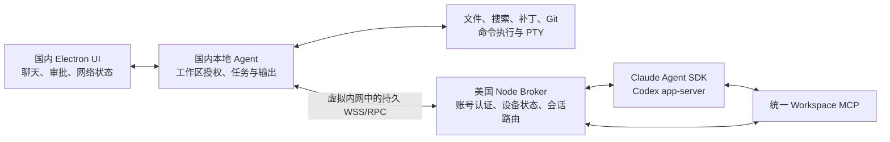
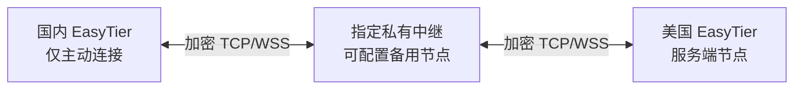
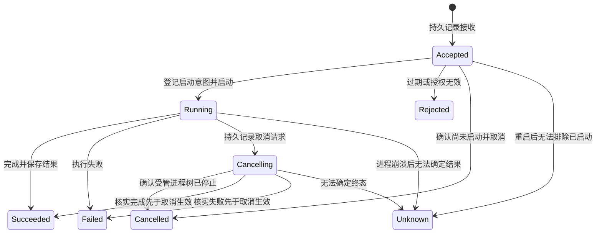
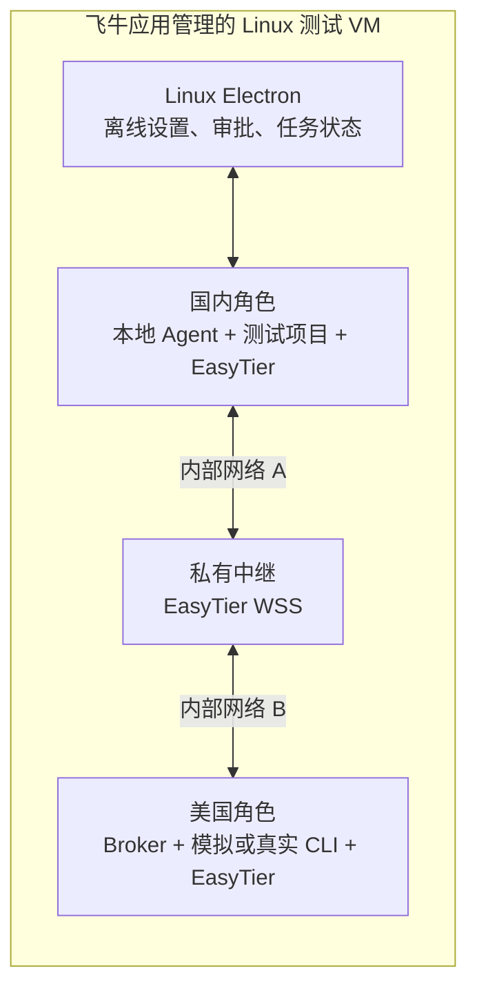

# 跨国远程 AI 协同开发工具调研与建议架构

- 调研与验证覆盖 2026-11-13 至 2026-11-19。
- Linux 桌面、账号和设备路由已在隔离环境与独立公网服务器完成实验验证。12.15 至 12.18 记录 IP、域名、Windows 原生只读和真实 Codex 工具调用的实测结果。常规消息入口、真实 CLI 的取消与恢复、Claude 适配和生产集成仍待完成。
- 项目基线：Anywhere Coding 当前工作树，包含尚未提交的多账号、remote MCP 等改动；不只以已提交版本为准。
- 2026-11-14 经用户授权开始环境搭建。12.6 至 12.18 记录隔离环境、账号、桌面和工具协议的实现与验证。
- 已确认实施约束：现有 Anywhere Coding 持续运行；首版 Linux x86_64，Windows/macOS 后续单独适配；实验采用独立源码与数据、飞牛虚拟机应用管理的 Linux VM、VM 内 Docker 网络实验；镜像和实验大文件目标位置为 `/vol1/1000/`，具体规则见 12.3 至 12.5。
- 2026-11-15 确认先用模拟宿主跑通工作区与桌面链路。2026-11-19 启用美国服务器已登录的 Codex CLI 做首轮只读验证。
- 阅读约定：下文“现有”表示代码中已经存在；“已核实”表示有代码或官方资料依据；“建议”表示拟采用的设计；“待验证”表示需要原型或目标平台测试。

## 1. 结论

可以在当前项目基础上增量实现。推荐架构为：**双端内嵌 EasyTier + 国内主动建立的持久 WebSocket/RPC + 统一 MCP 工作区执行器 + Electron 桌面 UI**。

美国主机保留 Claude Code / Codex 的进程、模型连接和会话管理；国内电脑保留项目文件、开发工具链和命令执行进程。AI 通过 MCP 发出工作区操作，服务端经虚拟内网转发给国内执行器，再把执行结果正常返回给 AI。

当前项目已经有 Claude Agent SDK、Codex app-server、远程 MCP 工具、网页聊天与审批、终端展示和事件存储。最值得复用的是现有的工具与 Agent 分层。主要新增工作包括：

1. 将 SSH/SFTP 后端抽象为可替换的工作区执行器，新增 WS/RPC 实现。
2. 增加国内本地执行器，负责文件、搜索、补丁、Git、命令、PTY 与任务状态。
3. 增加账号登录后的设备自动登记、服务端设备管理、双端 EasyTier 管理、工作区授权和异常回收。
4. 增加工具调用与操作的持久关联、任务生命周期、取消确认、输出续传和恢复前的状态核对。
5. 以设备、工作区和仓库标识贯穿项目分组、记忆、Git、管家自动化及历史迁移。
6. 复用现有 React UI，增加桌面传输与认证适配、离线启动、Electron 壳和网络、设备、任务状态。

稳定性收益主要来自线路质量、操作批处理、持久任务与恢复协议。TCP/WSS、虚拟内网和心跳都无法消除物理断网及 200–400ms 的往返时延。目标应定义为：**正常网络下减少感知延迟，短暂断网后自动恢复，避免因连接中断丢失状态或重复执行操作。**

实施前必须补齐的设计门槛是：恢复前先对账、任务完成与 CLI 回合结束分别建模、国内执行器落实权限、执行目标贯穿所有调用路径，以及本地页面的传输和离线启动。稳定编号、授权、取消和重启对账必须随首个执行闭环交付，不能留到后期再补。第 12 节按此调整实施阶段。

## 2. 需求范围与实现边界

| 需求 | 建议实现 | 必须说明的边界 |
| --- | --- | --- |
| 双端直接内嵌组网内核 | 安装包携带固定版本 EasyTier 二进制，由网络 helper 管理 | 用户无需额外安装 EasyTier；首版不做 Rust FFI |
| 自动提权与后台启动 | 首次安装或启用时系统授权，之后自动启动特权 helper | 默认系统安全设置下无法保证首次无提示获得管理员权限 |
| 指定中继、加密 TCP/WSS、禁 UDP 打洞 | 固定协议与中继白名单，关闭打洞及相关 UDP 功能，配合宿主网络策略 | 单个 `disable-p2p` 或 `disable-udp-hole-punching` 开关不足以证明没有其他路径 |
| 长连接、心跳、自动重连 | 国内主动连接美国 broker，连接支持双向 RPC | 网络恢复还需要操作层补交结果、查询状态和续传 |
| 美国托管两种 CLI | Claude Agent SDK；Codex app-server，经本机 stdio 集成 | 不依赖解析终端画面来提取工具调用 |
| 国内执行文件与终端操作 | 统一工作区执行器，文件 API 与命令执行分别实施边界 | `cwd` 和路径字符串校验无法单独约束任意 shell 命令 |
| Electron 复用网页 UI | 本地打包 React 页面、传输与认证适配、窄 preload IPC、关闭硬件加速 | 本地设置独立于远端登录；关闭硬件加速不等于承诺系统中完全没有 GPU 相关进程 |
| 主程序退出清理组网 | helper 管理实例租约与进程树，正常退出清理、异常死亡回收 | 不能仅依靠 Node/Electron 的退出回调 |

项目主副本与工具链可以留在国内；AI 按需读取的文件内容、命令输出和会话内容仍会发送到美国服务端及所使用的模型服务。这里不包含“源码内容完全不出本机”的承诺。

## 3. 当前项目现状

### 3.1 可复用模块

| 模块 | 已有能力 | 代码入口 |
| --- | --- | --- |
| Claude 适配器 | SDK `query`、流式输入输出、resume、工具审批、工具集合限制、MCP 注入、别名 | [server/src/agents/claude.ts](../server/src/agents/claude.ts) |
| Codex 适配器 | 每会话 app-server、stdio JSON-RPC、通知、审批、thread/turn 生命周期 | [server/src/agents/codex.ts](../server/src/agents/codex.ts)、[codexAppServer.ts](../server/src/external/codexAppServer.ts) |
| 远程 MCP | `run`、文件读写编辑、`apply_patch`、附件与记忆工具 | [server/src/remote/mcp.ts](../server/src/remote/mcp.ts) |
| 远程传输 | 系统 SSH/SFTP；SSH ControlMaster 连接复用；命令、文件、目录操作 | [server/src/remote/ssh.ts](../server/src/remote/ssh.ts) |
| 普通账号约束 | Claude 工具白名单与别名；Codex 本机功能限制；账号环境说明与记忆 | [server/src/agents/account.ts](../server/src/agents/account.ts) |
| 聊天长连接 | 服务端 30 秒 ping/pong；按 `afterSeq` 回补持久事件 | [server/src/routes/ws.ts](../server/src/routes/ws.ts) |
| 前端重连 | 25 秒应用心跳；1、2、4、8、10 秒上限退避；重连后重订阅 | [web/src/lib/socket.ts](../web/src/lib/socket.ts)、[store.ts](../web/src/lib/store.ts) |
| 会话和事件 | SQLite WAL、完整 AgentEvent 落盘（LiveDelta 除外）、广播 | [server/src/db.ts](../server/src/db.ts)、[sessions.ts](../server/src/sessions.ts) |
| 网页 UI | React 聊天、审批卡片、附件、变更视图、xterm | [web/src/components](../web/src/components) |
| Git 和终端 | 服务端 Git/worktree 操作；node-pty 终端及回放 | [server/src/git.ts](../server/src/git.ts)、[worktrees.ts](../server/src/worktrees.ts)、[terminals.ts](../server/src/terminals.ts) |

依赖声明包含 Claude Agent SDK `^0.3.310`、Codex `0.164.0`、Fastify `^5.12.5`、`@fastify/websocket` `^11.3.4`、node-pty `^1.1.0`、React `^19.3.0`、Vite `^8.3.4`。这些是 package.json 中的声明，不等同于已运行进程的实际版本。当前没有 Electron 或 EasyTier 集成。

### 3.2 与目标的具体差距

- **目录边界不完整。** `remotePath()` 接受绝对路径、`~`、盘符；`startCwd` 只是初始目录，`run` 可以自由执行命令与切换目录。现有 `files.ts` 的本机目录校验不能直接约束国内 shell。
- **远程命令结果没有完整实时流与恢复协议。** 当前 SSH 包装主要等待子进程结束后收集 stdout/stderr；后台任务返回日志路径，缺少统一 `operationId`、持久状态与恢复查询。
- **聊天恢复不等于操作恢复。** 完整 AgentEvent 可以回补，但 `LiveDelta` 明确不落盘。`ClientMessage.send` 没有提交消息编号和确认协议，无法据此推导提示词或命令具备去重保证。
- **现有补丁不是跨文件事务。** `apply_patch` 会先验证 hunk，但随后逐文件经 SFTP 写入或删除；中途断开仍可能留下部分修改。
- **角色与执行位置耦合。** `sessions.ts` 的 `accountSpec()` 让管理员使用服务器本地工具，普通账号使用 SSH。通用产品应让执行目标独立于管理员角色。
- **Git、diff、worktree 和原始终端尚未路由到国内。** 普通账号的相关 API 被限制；`TerminalManager.create()` 在服务器本机创建 PTY。只改 AI 工具会造成 UI 与 AI 操作位置不一致。
- **会话历史恢复不等于原进程恢复。** 进程重启后需要重新加载会话；在途工具调用、未完成输出与国内任务之间的关联需要新增机制。

### 3.3 复用现有代码时必须调整的行为

以下为静态审查确认的现状；其对新架构的影响与修正方案尚需原型验证。

| 现有行为与代码依据 | 迁移后的影响 | 设计落点 |
| --- | --- | --- |
| [sessions.ts](../server/src/sessions.ts) 启动时将非 idle 会话置为 idle；[loop.ts](../server/src/loop.ts) 15 秒后自动续跑；[codex.ts](../server/src/agents/codex.ts) 对部分模型错误重新发送提示词 | 国内操作可能未结束；模型重新发起的调用会使用新编号，单纯 RPC 去重无效 | 7.2、7.4：持久关联与恢复屏障 |
| [sessions.ts](../server/src/sessions.ts) 的 idle 触发完成通知与自动交接；runner 按空闲回收 CLI；[remote/mcp.ts](../server/src/remote/mcp.ts) 忽略取消通知 | 异步国内任务不在现有完成、关闭、停止逻辑内 | 7.3、7.6：任务完成、唤醒与取消 |
| [projects.ts](../web/src/lib/projects.ts) 按路径分组；[advisors.ts](../server/src/advisors.ts) 按账号与路径定位记忆；[handoff.ts](../server/src/handoff.ts)、[loop.ts](../server/src/loop.ts) 直接操作本机 Git | 多设备同路径可能混用项目；开放远程管家后自动化可能落到美国 | 4.4、8.4、8.5：身份、路由与派生授权 |
| [api.ts](../web/src/lib/api.ts)、[socket.ts](../web/src/lib/socket.ts) 使用页面同源地址；[App.tsx](../web/src/App.tsx) 将 me() 失败视为未登录 | 本地打包页面不能直接连接美国接口，断网启动也无法进入本地设置 | 9.1：桌面传输、认证与离线入口 |
| [NewDialogs.tsx](../web/src/components/NewDialogs.tsx) 用 CLI 模式描述只读、计划、审批；当前 MCP 写工具直接执行远端写入 | 美国 CLI 设置不能自动形成国内执行边界 | 8.1：权限映射与执行前校验 |
| [sessions.ts](../server/src/sessions.ts) 的 resync 删除并重新编号事件，只实时广播 reset；[store.ts](../web/src/lib/store.ts) 按旧 afterSeq 回补并过滤小序号 | 离线错过 reset 后可能持续漏掉新历史 | 7.7：历史代次与联合游标 |
| [remote/mcp.ts](../server/src/remote/mcp.ts) 并行处理请求，共用会随命令完成而变化的 cwd | 并发完成顺序会改变后续相对路径；MCP 重建后目录状态丢失 | 8.3：显式工作目录 |

## 4. 推荐架构

### 4.1 应用与执行数据流

图中的业务连接由国内本地 Agent 主动建立。美国服务端通过同一连接发起反向操作，无需国内公网端口。网络中断时，国内进程可按任务策略继续运行，输出暂存在本地。

### 4.2 组网拓扑

最小部署允许美国主机兼任组网中心，此时国内直接连接该中心的指定协议端口。如果要求两端流量必须经过独立中继，则双方只配置中继 peer，不互设 endpoint peer。

### 4.3 模块职责

| 组件 | 责任 | 权限与存储位置 |
| --- | --- | --- |
| Electron renderer | 展示 UI、提交提示词、审批、显示状态 | 不拥有任意 shell 或文件 API |
| 国内本地 Agent | 登录后自动连接、工作区授权、RPC、任务管理、输出缓存 | 普通用户或受限执行环境；本地存储任务日志 |
| 国内执行器 | 文件、补丁、Git、构建、测试、PTY | 工作区权限与操作系统隔离 |
| 网络 helper | 启停 EasyTier、TUN、路由、实例回收 | 仅此组件持有必要网络特权 |
| 美国 broker | 设备连接、RPC 路由、权限检查、会话事件 | 独立设备身份与账号授权 |
| 美国 Agent runner | 托管 Claude/Codex，维护会话与流式事件 | 会话与模型凭证按部署身份管理 |
| Workspace MCP | 将 AI 工具转换为工作区操作 | 只接收授权设备与工作区标识 |

建议将账号、设备、工作区、会话分别建模：账号可以拥有或获授权访问设备；设备在本地声明工作区；会话固定绑定执行设备和工作区。管理员身份只决定管理权限，不隐式决定执行机器。

### 4.4 项目身份、执行目录与历史迁移

路径不是跨设备的项目主键。同一账号两台电脑上的 `/home/me/app` 或 `C:\work\app` 应视为不同工作区；改名和移动目录也不能自动变成另一个设备上的项目。

| 标识或字段 | 建议语义 |
| --- | --- |
| `deviceId` | 账号下以安装凭据识别的稳定设备。重连、IP 或显示名称变化保留身份。新安装使用新身份，旧会话保留原目标 |
| `workspaceId` | 本地授权工作区的稳定身份，绑定设备及授权记录；根目录由国内解析 |
| `repositoryId` | 本设备上的仓库身份，供同一仓库的主工作树与派生 worktree 关联；不能用远程仓库 URL 自动合并不同克隆 |
| `runnerCwd` | 美国 CLI 的会话运行目录，与国内项目目录分开存储 |
| `cwdRelative` | 本次操作在授权工作区内的相对起始目录；由国内解析和校验 |

会话、侧栏分组、管家记忆、需求书、自动转交、Git 状态缓存、终端与任务记录均应引用相应稳定标识。展示名称和路径独立存储；从工作区创建子会话时继承执行目标和授权引用，不依据当前账号角色或账号新配置重新选择机器。

数据库迁移需要保留现有本地和 SSH 会话的执行语义。可为旧会话登记明确的 legacy 执行目标；无法可靠确定原目标时仅允许查看历史，显式绑定并核对后再执行。导入 CLI 历史不能仅凭 `cwd` 猜国内设备，也不能因为账号角色变化而悄悄切换目标。旧版支持不纳入“国内工作区会话全部在国内执行”的验收范围，但 UI 必须标明其执行位置。

### 4.5 账号登录与多设备会话

客户端使用服务端账号登录。首次成功登录自动登记本次安装，建立 MCP 链路。用户不需要配对码或额外的设备确认。服务端区分当前操作界面的设备与实际执行工具的设备，两者可以不同。

| 用户操作 | 服务端和界面行为 |
| --- | --- |
| 在 A 上新建会话 1 | 服务端从已认证的客户端确定账号和设备，从 A 的项目中确定工作区，一次性保存三个标识。 |
| 同账号在 B 打开会话 1 | B 可以继续发送指令和查看历史。会话标题处显示“此会话只能操作设备 A”，并标明当前在 B。读取、修改与停止都路由到 A 的原工作区。 |
| A 离线，B 在线 | 会话 1 显示 A 离线及最近在线时间，保留历史，暂停新工具调用。A 重连后继续原会话。若要操作 B，在 B 的项目中新建会话 2。 |
| 查看设备 | 客户端侧栏与会话标题显示设备名及在线状态。服务端管理页按账号列出设备、最近在线时间和绑定会话。管理员可停用单台设备。 |

服务端以设备连接与心跳维护在线状态，再单独校验项目链路和本地工作区授权。即使两台机器同名、目录相同，服务端也按稳定设备和工作区标识路由。设备上的账号退出、切换账号或被停用时，其旧连接失去执行权限。管理页的设备列表只向管理员展示跨账号信息。

## 5. EasyTier 组网方案

### 5.1 内嵌与版本策略

首版建议随安装包携带 `easytier-core`，并按需要携带 `easytier-cli`，由 helper 作为受监管子进程启动。用户无需单独下载、配置或操作 EasyTier。独立进程有利于跨平台打包、崩溃隔离和升级。

调研对照过 EasyTier **v2.6.4** 的官方源码与文档；下表中的版本相关事实以该版本为依据，不能直接套用官网随后新增的字段。正式开发前应固定版本、二进制哈希、来源、平台架构及驱动依赖，并重新验证配置。[v2.6.4 发布页](https://github.com/EasyTier/EasyTier/releases/tag/v2.6.4)

### 5.2 限定 TCP/WSS 与中继

以下是配置策略说明；固定版本的实际实验配置与运行结果见 12.6、12.7。

| 目标 | 调研确认的配置或约束 | 注意事项 |
| --- | --- | --- |
| 端点仅主动连接 | `--no-listener`；peer 仅列指定中继的 `wss://` 地址 | 只关闭 EasyTier 底层 listener，不关闭管理 RPC 或业务 listener；兼任中心的美国节点仍需显式监听 |
| 中继只监听 WSS | 显式指定 `-l wss://0.0.0.0:443/` | 不使用会展开多种协议的纯数字 listener 形式；确认端口占用、是否经反向代理终止 TLS，以及原生 WSS 的身份验证边界（见 5.4） |
| 关闭自动 P2P | `--disable-p2p`；所有受管端点不启用 `--need-p2p` | 官方存在 `need-p2p` 例外，不能只看前一个开关 |
| 关闭 UDP/TCP 打洞 | `--disable-udp-hole-punching`、`--disable-tcp-hole-punching` | 可同时关闭对称 NAT 打洞；打洞关闭不代表其他 UDP 功能均关闭 |
| 关闭 UPnP | `--disable-upnp` | 避免自动操作路由器端口映射 |
| 关闭 UDP 型加速路径 | 不启用 KCP/QUIC proxy；`--disable-kcp-input`、`--disable-quic-input`、`--disable-relay-kcp`、`--disable-relay-quic` | 以所分发版本实际 CLI/config schema 为准 |
| 关闭 STUN | TOML 显式配置 `stun_servers = []`、`stun_servers_v6 = []` | 清空后的实际网络行为需要原型抓包确认 |
| 限定 IPv6 路径 | 按部署需要使用 `--disable-ipv6`，配合底层网络规则 | 不能据此推断整机 IPv6 已禁用或所有 IPv6 底层路径均被封锁；需验证进程出站行为 |
| 管理接口仅本机 | `--rpc-portal 127.0.0.1:<管理端口>` | 不暴露公网或整个虚拟内网 |
| 保持加密 | 启用 Secure Mode，不启用禁用加密选项 | 设备认证另行实施 |

依据：[官方配置选项](https://easytier.cn/en/guide/network/configurations.html)、[v2.6.4 CLI 源码](https://github.com/EasyTier/EasyTier/blob/v2.6.4/easytier/src/core.rs)、[KCP/QUIC 说明](https://easytier.cn/en/guide/network/kcp-proxy.html)、[P2P 说明](https://easytier.cn/en/guide/network/p2p-optimize.html)。`need-p2p` 例外也可在 [v2.6.4 连接器源码](https://github.com/EasyTier/EasyTier/blob/v2.6.4/easytier/src/connector/mod.rs#L24) 核查。不要误用 `--p2p-only`，该选项会禁止中继，方向与本需求相反。

还应关闭本产品不使用的子网发布、VPN portal、广播转发等能力，禁止回退到公共节点或未授权发现服务。具体开关需要按固定版本整理，不使用猜测的参数名。

### 5.3 “不走 UDP”的验证口径

交付口径建议定义为：**EasyTier 底层隧道与节点发现不使用 UDP，不启用 UDP 打洞、QUIC/KCP 等替代路径。** 不将操作系统自身必要的 DNS 等活动混算为隧道协议；如果部署还要求这些活动也禁 UDP，应额外设计 DNS 与宿主网络策略。

验证分三层进行：

1. 配置层关闭非目标功能，并核查生效配置，而非只检查启动参数字符串。
2. 宿主防火墙或进程网络策略将受管端点的 EasyTier 底层出站限定到批准中继的 TCP 端口；按可执行文件、专用身份或其他平台支持的粒度管理，不能对整机或共享用户直接全局禁 UDP。中继另行允许批准端口入站与已建立连接的回包。Node 的模型 API、包管理等网络权限分开管理。规则应区分物理网络与虚拟接口，不能误封工作区所需的 overlay 流量。DNS 解析策略、中继域名地址变化及其规则更新也需验证。各平台能否达到所需隔离粒度属于原型验证项。
3. 在启动、稳定运行、断线重连、休眠唤醒、中继失败和备用节点切换阶段抓包，核实没有 UDP 隧道、未批准直连或公共节点回退。

### 5.4 加密与身份认证

EasyTier 的 Secure Mode 支持节点间独立协商密钥、中继公钥固定等能力。建议双端启用 `--secure-mode`，中继持有稳定私钥，端点通过 `peer_public_key` 固定中继身份。[Secure Mode 官方文档](https://easytier.cn/en/guide/network/secure-mode.html)

一个版本相关事实需要保留：v2.6.4 的外层 WSS 连接跳过证书信任链与主机名验证，仍保留 TLS 加密与握手签名校验。因此不能仅依据 `wss://` 前缀推断服务端身份已按常规 HTTPS 客户端规则验证；该结论不适用于另外实现的应用层 Node WSS/mTLS。[对应稳定版 TLS 源码](https://github.com/EasyTier/EasyTier/blob/v2.6.4/easytier/src/tunnel/insecure_tls.rs)

桌面在经过服务端身份校验的 TLS 上登录账号，获准后自动登记本次安装并建立设备连接。服务端将登录凭据关联账号和设备，设备离线重连时核验有效期与停用状态。正式安装需支持凭据保护与轮换。工作区授权绑定账号、设备、会话和操作类型；同处虚拟内网不自动获得操作权限。中继节点只承担组网转发，不应获得工作区操作授权。

### 5.5 提权与生命周期

可实现的默认体验是“首次安装或启用时系统授权，之后自动后台启动”。不能把绕过 Windows UAC、macOS 授权或 Linux 管理员控制作为正常设计。Windows 官方建议将需要管理员令牌的工作放入独立组件。[Microsoft UAC 说明](https://learn.microsoft.com/en-us/windows/win32/secbp/running-with-administrator-privileges/)

建议采用平台对应 helper/service 机制：Windows service、Linux systemd、macOS 受支持的 helper/service。只授予组网所需能力，Electron 与项目命令执行器不随之提权。

| 事件 | 建议行为 |
| --- | --- |
| 首次启用 | 系统授权、安装或注册 helper、生成设备身份 |
| 主程序启动 | helper 校验调用者，启动本次 EasyTier 实例，等待就绪 |
| 网络中断 | 保留实例、退避重连、恢复后重新核对应用连接状态 |
| 用户主动退出产品 | 停止接收新操作，按策略收尾任务，停止组网实例并清理 TUN/路由 |
| 主程序异常死亡 | helper 通过 IPC 关闭或租约超时回收实例 |
| EasyTier 崩溃 | 主程序仍存活时限速重启，更新 UI，并重新建立应用连接 |
| 系统关机或重启 | 由系统服务机制收尾，下次启动核对并清理本产品遗留资源 |

正常退出需要显式 stop、等待、超时终止进程树。异常回收可结合 Linux cgroup、Windows Job Object 等机制；具体跨提权进程的归属与行为需要目标系统测试。仅使用 `process.on('exit')` 无法覆盖强制终止或崩溃。[Windows Job Object](https://learn.microsoft.com/en-us/windows/win32/procthread/job-objects)

必须定义“关闭窗口”和“退出产品”的区别：如果关闭窗口只是最小化托盘，产品仍在运行；明确退出则释放本次组网实例。安装的 helper 可以保留，但不能因此留下持续运行的会话隧道。

### 5.6 可选模式与许可

EasyTier 提供 No TUN 模式，可通过 SOCKS5 或端口转发工作，降低提权需求。本需求明确要求虚拟内网互通，首版建议采用 TUN + helper；No TUN 只作为以后单独验证的模式。[No TUN](https://easytier.cn/en/guide/network/no-root.html)、[端口转发](https://easytier.cn/en/guide/network/port-forward.html)

内核分发应以实际所分发版本的 LICENSE 为准。调研所查 EasyTier 仓库 LICENSE 为 LGPL-3.0，不能将文档站页脚的 Apache-2.0 当成内核许可证。打包时需记录版本、许可证、版权和对应源码获取方式；若修改内核，保留可追溯补丁。[EasyTier LICENSE](https://github.com/EasyTier/EasyTier/blob/v2.6.4/LICENSE)

### 5.7 虚拟网络内部的访问隔离

5.3 节限制的是底层隧道出站；应用层 mTLS 或签名保护的是产品 RPC。两者都不能自动保护机器上其他监听于 `0.0.0.0` 或虚拟 IP 的服务，例如 SSH、数据库和开发服务器。`--no-listener` 也不等于关闭虚拟接口上的业务入站。

建议明确账号之间采用独立虚拟网络还是受控的共享网络，并在双端设置虚拟接口入站白名单：默认拒绝不必要的新连接，仅允许设备访问指定 broker 业务端口及已建立连接的返回流量。国内反向操作通过设备主动建立的同一连接传递，无需因此开放任意国内业务端口。调试端口和预览服务应单独授权，只对获得相应授权的节点开放。

EasyTier 官方提供入站等方向的 ACL 能力；具体字段、身份规则、连接跟踪与宿主防火墙组合应按锁定版本核对，不能直接把滚动文档示例当成已验证配置。[官方 ACL 文档](https://easytier.cn/en/guide/config/acl.html)

验收应从同账号其他设备、不同账号设备及中继分别验证访问范围，并覆盖密钥撤销、网络重连和备用中继切换。所有规则需区分物理接口与虚拟接口，避免为收紧隧道路径而误封合法业务流量。

## 6. 美国服务端与 CLI 接入

### 6.1 Claude Code

沿用 Agent SDK `query()`，由 SDK 托管 Claude 子进程，并通过结构化事件展示输出、工具调用、权限与会话状态。官方部署文档说明 SDK 会启动 Claude Code 子进程，适合当前产品集成方式。[Agent SDK Hosting](https://code.claude.com/docs/en/agent-sdk/hosting)

工作区操作建议经统一 MCP 实现：文件读写、搜索、编辑、补丁、命令启动、任务查询、取消、日志读取。MCP handler 经 broker 转发 RPC，收到国内结果后返回 MCP `content` / `structuredContent` / `isError`。[自定义工具](https://code.claude.com/docs/en/agent-sdk/custom-tools)

当前官方 TypeScript reference 提供 `toolAliases`，可以将 `Bash` 等内置工具名称映射到 MCP 工具。当前项目已经使用这一机制。[TypeScript SDK reference](https://code.claude.com/docs/en/agent-sdk/typescript)

需要遵守以下语义：

- 别名是单跳名称解析，不自动转换工具参数。包装器需兼容原生工具常见入参，再转换为通用 RPC。
- 别名不替代工具集合限制。本地 SDK 类型明确说明，它不覆盖持有工具对象的 harness 内部直接调用路径。
- `allowedTools` 主要决定自动批准，不能当成工具集合白名单。SDK `tools` 可选择内置工具集合，空数组可关闭内置工具；MCP 配置需要另行限制。
- 对工作区的内置读写、命令与其他本机能力应按已验证版本限制，并以美国进程隔离和负面测试补强。
- 当前普通账号路径移除了工作区文件与命令类内置工具，保留必要的会话工具及 WebSearch/WebFetch；后两者仍可能使用美国服务端网络，并限制 MCP 来源。应以该路径继续扩展。

CLI 的 `stream-json` 也能作为结构化接口备选，但现有 SDK 已处理双向输入、审批与生命周期，首版没有必要改成 node-pty 解析 TUI。[CLI reference](https://code.claude.com/docs/en/cli-reference)

### 6.2 Hook 的定位

PreToolUse 适合检查、审批、拒绝、修改入参和补充上下文。它没有通用的“跳过原工具、成功返回任意远程执行结果”接口。PostToolUse 即使能修改返回内容，也发生在原操作执行之后，不能阻止原操作对美国主机产生副作用。[Hooks reference](https://code.claude.com/docs/en/hooks)

因此 hook 用作额外护栏，MCP 用作主要执行通道。不将拒绝原因或上下文文本当成正常工具结果。

### 6.3 Codex

沿用当前每会话 app-server 和本机 stdio JSON-RPC：创建/恢复 thread、启动/中断 turn、接收事件、回答审批。跨国连接由本项目 broker 管理，避免将 CLI 的远程监听与产品可靠协议混在一起。[Codex app-server](https://learn.chatgpt.com/docs/app-server)

使用相同 Workspace MCP 提供国内文件和命令能力。现有代码会关闭本机 shell 等 features，并对成员会话使用只读沙箱；正式实现时必须核对固定 Codex 版本中各开关的实际语义与生效结果，不能只根据配置项存在就认为已形成隔离。[Codex MCP](https://learn.chatgpt.com/docs/extend/mcp?surface=cli)、[配置基础](https://learn.chatgpt.com/docs/config-file/config-basic)

当前官方还有两类可研究的扩展：

- app-server 的实验性 `dynamicTools` / `item/tool/call`，可让宿主执行自定义工具，但首版统一 MCP 更利于与 Claude 共享实现。
- 远程执行环境与 `exec-server`。本地安装的 Codex `exec-server --help` 也将其标为实验性。官方 app-server 文档提供实验性 `environment/info`。这可以作为后续原型方向，不能据此承诺现有版本已具备符合本产品要求的恢复、授权与跨平台行为。

`codex --remote` 连接远程 app-server 的终端 UI，与“美国 Agent 使用国内文件和执行器”是不同的接入层，不能仅配置远程 UI 就认为工作区已迁移。

### 6.4 原生功能与账号边界

MCP 接通后，依赖 CLI 进程本地文件系统的功能仍需逐项适配：项目说明文件、技能与插件发现、checkpoint、自动文件变化感知、LSP、worktree、子代理与看图等。应在能力表中明确支持、替代或暂不开放，避免误落美国目录。

`spawnClaudeCodeProcess` 改变的是整个 Claude 进程运行位置；Claude Remote Control 也主要把 UI 连接到 Claude 所在机器，不能直接完成本需求的执行分离。[Claude Remote Control](https://code.claude.com/docs/en/remote-control)

当前项目共享美国主机已有的 CLI 登录与额度。通用产品需要明确个人自用、受控多用户部署或对外产品的账号模式，独立管理凭证和授权，不能默认沿用共享身份。Claude SDK 对第三方产品登录与额度使用有专门要求，产品化时按官方规定核对。[SDK quickstart](https://code.claude.com/docs/en/agent-sdk/quickstart)

## 7. 双向 RPC 与可靠执行

### 7.1 连接与协议

建议将 UI 会话链路与设备执行链路分开管理。美国 CLI 与 MCP 使用本机 stdio；国内 Agent 主动通过虚拟内网与 broker 建立 WSS。设备链路具有独立身份，不复用浏览器 Cookie 作为设备长期凭证。

建议操作信封至少包含以下信息，字段名称在开发时定稿：

| 信息 | 用途 |
| --- | --- |
| 协议版本、能力集合 | 双端版本协商、拒绝不兼容操作 |
| 账号、设备、工作区、会话及回合标识 | 路由、工具调用关联与逐次授权 |
| 请求编号、`operationId`、工具调用标识 | 分别关联单次 RPC、稳定操作和 CLI 调用，不能互相替代 |
| Agent 实例标识、连接代次、回合执行代次 | 拒绝旧连接或已停止回合的迟到新操作；任务身份独立于连接 |
| 操作类型、参数及摘要、期限、显式相对 cwd | 执行、冲突识别与过期处理；不能依赖进程内可变 cwd |
| 授权版本、审批凭据或策略引用 | 国内执行前核验权限与参数，防止沿用过期授权 |
| 输出序号、确认位置 | 输出排序、续传、流量控制 |
| 文件预期版本或内容哈希 | 并发修改检测 |
| 状态与结构化错误 | 区分离线、拒绝、冲突、超时、执行失败、状态不明 |

不在美国端拼接国内绝对路径，也不相信服务端随请求提供的新根目录。国内根据本地授权记录解析 `workspaceId`。账号和执行目标由已认证上下文及会话绑定核对，不能只信任请求自报的标识。协议需明确期限的时钟误差处理、大小限制和能力不匹配错误。

### 7.2 操作状态与去重

本地 Agent 在接受操作后记录状态，重复的 `operationId` 返回原状态或结果，不再次启动。取消是一个需要确认的操作；发送取消请求不等于原命令已停止。

稳定编号的责任建议如下：

1. 美国 broker 在首次派发前持久记录 `sessionId / turnId / toolCallId → operationId → requestHash`，国内持久记录该操作及其 `taskId`、状态、输出和终态结果。每次传输的 `requestId` 可以不同，同一操作重传必须沿用 `operationId`。
2. 工具调用上下文由宿主适配层经可信 IPC 等方式关联，不要求模型生成可信编号。当前 MCP 配置与 `Tool.run()` 没有稳定的会话、回合、工具调用上下文；stdio JSON-RPC id 只标识该进程中的请求，不能直接用作全局操作编号。两种 CLI 的事件如何与 MCP 调用准确关联，必须分别原型验证。
3. `requestHash` 覆盖目标、操作类型、规范化参数、cwd 等执行语义；更换连接或重试不能改变操作含义。连接代次、传输编号与可轮换凭据应单独校验，避免合法重连被误判为参数冲突。
4. 结果到达 broker、展示到 UI、被 CLI 纳入上下文是不同的交付阶段，需要持久记录。CLI 重建后先核查旧调用和结果；不支持恢复原调用时，明确作为恢复上下文交付，不伪造原请求已成功完成。

去重记录应在启动操作前持久化，并以唯一约束处理并发重发；每次查询仍先检查账号、设备和工作区授权。相同编号携带不同操作参数或授权范围时必须拒绝，不能视为同一个操作执行或返回结果。启动与状态记录之间的崩溃仍需要核对，无法确定时进入状态待核实流程。

对任意 shell 命令不能笼统承诺“恰好执行一次”。进程崩溃、外部服务副作用和结果记录之间存在无法统一原子提交的情况。设计目标是稳定编号、持久去重、启动与结果核对，以及状态不明时停止自动重跑。

还必须区分传输重试与模型重新发起调用。国内命令完成但工具结果未进入 CLI 历史时，恢复后的 AI 可能再次请求相同命令，并获得新的工具调用标识；仅检查 `operationId` 无法阻止这类重复副作用。不能按命令字符串猜测两次调用是否相同，应通过 7.4 节的恢复屏障先核对旧任务和结果，再允许新的自动执行。

双端去重记录与取消记录需定义保留期。超过可恢复期限的旧编号应明确拒绝或进入待核实流程，不能因本地记录已清理就当作新操作启动。

提示词提交也需要消息编号、接收确认和恢复查询，避免客户端重连后重复启动 AI 回合。

### 7.3 长任务与输出

建议命令能力采用启动、查询、输入、调整 PTY、取消、读取输出、获取结果的分离接口。长构建或测试返回任务标识，再按需查询；不要让一个 MCP 调用无限挂起等待网络或任务完成。MCP 自身超时与任务运行期限分别管理。

国内异步任务必须接入会话调度。当前 runner 的 idle 表示 CLI 回合结束，不能据此发送“任务已完成”通知或启动自动交接。建议分别保存推理状态与执行状态，对外区分等待任务、等待设备、恢复核对和真正完成。

| 任务类别 | 完成与调度规则 |
| --- | --- |
| 本回合依赖的构建、测试等有限任务 | 终态与必要结果交付前，不把整体工作标为完成，不触发依赖结果的交接或合并 |
| 用户明确允许保留的后台服务 | 单独展示任务状态，不无限阻止对话完成；退出、取消与会话删除时按已声明策略处理 |
| 状态不明或尚未对账的任务 | 进入恢复核对，阻止相关自动执行；保留查询、诊断和取消入口 |

任务完成应生成持久事件，broker 记录结果与待交付状态，再按 CLI 能力交付给仍在运行的回合，或在安全恢复后调度后续回合。已有回合、审批等待或用户停止意图必须优先处理，不能每收到一次重传通知就重复唤醒 AI。CLI 可以按策略回收，但任务记录和待交付结果不能随 MCP/CLI 进程消失；唤醒前应核对交付记录和 CLI 历史，交付状态不明时不能自动重跑任务。压缩、删除会话和关闭产品也要检查关联任务。

stdout/stderr 或 PTY 输出需要有序分块、本地有上限的落盘缓存、最后确认序号、重连续传和背压。日志截断时返回明确位置，避免静默丢失。终端原始输入也不能在断线后无条件重放。

文件传输采用二进制分块、偏移量、校验和与长度限制；大附件不能阻塞心跳、审批或取消。控制消息优先处理，文件和日志流限速；即使分成多个业务连接，也仍需评估共享 EasyTier TCP 隧道的队头阻塞。

### 7.4 故障恢复

| 故障 | 预期处理 |
| --- | --- |
| UI 断线 | 若设备执行链路仍在，美国 Agent 可继续；UI 用历史代次与序号重订阅 |
| 国内到美国链路断线 | 国内已启动任务按策略继续，日志缓存；新工具调用等待或返回设备离线状态 |
| 链路恢复 | 重新认证并建立有效连接代次；先核对未决操作、任务及输出，再解除恢复屏障 |
| 国内电脑休眠 | 明确显示设备不可执行；唤醒后检查旧进程和任务状态 |
| 国内 Agent 崩溃 | 核对本产品任务与进程；无法证明完成时标记状态待核实 |
| 美国 broker/CLI 重启 | 相关会话进入 recovering，核对国内任务和 CLI 结果交付状态；完成核对后才允许自动续跑 |
| 中继切换 | 允许业务连接重建；通过同一操作恢复协议处理 |
| 设备被撤销 | 拒绝新操作，断开该设备的执行连接，在途任务按实际结果核对。管理员恢复接入后需重新登录 |

任务恢复、会话恢复和原进程连续运行是三个不同目标，产品状态应分别表达。断线后的新操作不无限积压；必须有过期、取消和用户可见的排队状态。

建议将恢复流程设为明确的调度屏障：

1. 识别受影响会话并进入 `recovering`，暂停新副作用操作、自动续跑、巡视、交接与合并。不能照搬现有启动时统一置 idle 的行为，也不能在固定等待 15 秒后直接继续。
2. 读取美国操作日志，与国内任务、进程和结果记录核对；国内暂时离线则保持等待，不推断任务已失败或已停止。
3. 补传终态结果和缺失输出，核对它们是否已进入 CLI 历史。运行中的任务继续绑定原会话；`Unknown` 或无法关联的调用保留待核实状态。
4. 在必要结果已交付、授权仍有效且没有未决执行风险时解除屏障。用户已经停止的回合不自动续跑；相关工作区的其他自动写操作也不能绕过未决任务的协调。

屏障期间仍允许已授权的状态查询、取消和诊断。模型容量错误后的重试同样要检查在途操作，不能默认发送原提示词或“继续”就是安全的恢复方式。对于无法从记录确定的外部副作用，应明确展示已知事实并进入人工核对，不声称已经实现跨进程原调用恢复。

### 7.5 心跳与超时

现有 UI 的 25/30 秒心跳可以作为起点。设备链路建议独立测量应用 RTT，用多次丢失与总超时判断故障，避免在高 RTT、抖动或短时忙碌下过早判死。重连采用有上限的指数退避和随机抖动，网络恢复、唤醒时可触发立即探测。

具体间隔需结合中继与反向代理空闲超时确定。连接存活超时、工具调用等待、任务运行超时和离线任务保留时间应分别配置。

### 7.6 连接代次与取消竞态

每台设备只允许一个有效的执行连接归属。建议区分稳定 `deviceId`、本地 Agent 启动实例 `agentInstanceId` 和 broker 分配的 `connectionEpoch`。新连接接管时，broker 与国内 Agent 都核对当前代次；旧连接即使尚未判死，也不能继续提交新执行请求。国内还应防止同一授权工作区被两个未协调的 Agent 实例同时执行。

任务身份不随连接代次改变。新连接可以在重新授权后查询、续传或取消旧任务，不能因为换连接就生成新任务或清空去重记录。回合另设执行代次或停止标记，避免停止后迟到的调用获得新的执行机会。

取消需区分停止模型推理、取消本回合国内任务、保留明确授权的后台服务。当前 `sessions.interrupt()` 只调用 CLI interrupt，不能作为国内停止成功的证据。建议采用以下规则：

- 取消指向稳定 `operationId`，在国内持久记录；若取消先于启动请求到达，保存带目标和授权范围的取消记录，后续启动请求不能重新执行。
- 启动检查、取消标记和状态转换在国内串行仲裁。`Accepted` 可在尚未启动时转为 `Cancelled`；已运行任务先进入 `Cancelling`，确认受管进程树停止后才返回取消成功。
- 自然完成与取消竞争时保留核实后的实际终态，不能把已完成操作覆盖为取消成功。`Cancelled` 也不代表已经产生的文件修改或外部副作用被回滚。
- 离线点停止后显示取消待确认；broker 停止派发该回合的新操作，连接恢复后补交取消并对账。进程状态无法证明时保留 `Unknown`。

### 7.7 聊天事件的历史代次

当前 `resync()` 重建事件后从 1 编号，只向在线订阅者广播 reset。若客户端离线前已看到序号 1000，离线期间历史被重建为 800 条，重连仍携带 `afterSeq=1000`，就会漏掉重建历史及随后序号不超过 1000 的事件。

建议订阅和分页使用 `(historyEpoch, seq)` 联合游标。重建历史时原子更新代次与事件；订阅响应、事件批次、分页响应均携带代次。代次变化时客户端清空旧历史和临时增量并重新加载，拒绝旧代次的迟到分页与事件，不能只依赖实时 reset 通知。恢复订阅还应读取当前会话、任务和审批快照；`LiveDelta` 不落盘的限制应继续明确。

聊天事件序号与任务输出序号是两套独立游标，历史重建不得重置国内任务的去重、取消和日志续传记录。

## 8. 国内工作区与安全执行

### 8.1 本地授权

用户在国内电脑上选择项目根目录，生成工作区授权记录。服务端只能引用已有工作区，不能远程扩展授权范围。登录成功即可建立 MCP 链路，工作区新增和权限扩大由执行设备上的本地受信任 UI 完成。

授权至少区分文件读取、文件修改、命令执行、交互终端、Git 写操作和网络访问。保持已有审批体验，但执行器还要独立检查授权，不能只相信模型、提示词或网页审批状态。

美国 runner 隔离与国内工作区权限是两个维度。当前 Claude 有 `canUseTool`，Codex 有 MCP elicitation 审批处理，不能据此断言所有远程工具都绕过审批；但美国 CLI 的只读沙箱也不能限制另一个进程在国内写文件。现有界面文案与选项需要映射到可执行的国内策略：

| 产品权限语义 | 国内执行器应落实的规则 |
| --- | --- |
| 只读分析 / 只做计划 | 拒绝文件与 Git 写操作；任意 shell、PTY 默认不可用。若提供分析命令，必须有实际只读隔离并限制可产生外部副作用的网络访问，不能仅靠命令名称或提示词保证 |
| 自动接受文件编辑 | 仅自动放行已授权范围内的文件修改；不隐含批准命令、Git 写入、网络访问或扩展根目录 |
| 逐项确认 / 需要审批 | 在派发与执行前核对本次操作的有效审批，拒绝仅有界面“已确认”状态而无可核验记录的请求 |
| 智能审批 / 从不询问 / 全部放行 | 只决定授权范围内如何获得审批或拒绝请求，不能扩大本地工作区授权，也不能跳过 OS 隔离 |

审批应绑定账号、设备、工作区、回合、`operationId`、参数摘要、授权版本及有效期，凭据由可信组件签发或通过受认证通道核验；“本会话允许”需转成有范围和期限的策略记录。参数变化、权限收紧或工作区授权撤销后，排队操作在实际启动前必须重新校验，旧批准不能继续生效。

修改权限不自动撤回已经发生的副作用；对正在运行的任务应明确采用继续、取消或等待确认的策略并显示状态。UI 应分别展示美国 runner 限制与国内执行权限，避免沿用“超出沙箱直接失败”等文案却只改变美国 CLI 设置。

涉及跨端同步的权限收紧，broker 应立即按新限制停止派发；国内执行器确认新授权版本生效后，拒绝旧授权下尚未启动的操作。断网期间不能宣称国内已生效，UI 应显示待确认；恢复时先补交权限变更与取消请求并对账，再恢复派发。国内已接收但尚未获知变更的任务能否继续，取决于事先约定的离线执行策略。

### 8.2 文件操作

- 规范化路径并拒绝越出授权根目录的绝对路径、盘符、UNC、`..` 等输入。
- 核查真实路径、符号链接和 Windows junction/reparse point，不能仅使用字符串前缀判断。
- 对尚不存在的文件核查真实父目录；关注检查到使用之间的替换竞态，按平台采用安全打开方式或隔离边界。
- 限制文件大小、读取范围、传输量与二进制处理方式；保留中文路径、CRLF、文件权限及编码策略。
- 编辑和补丁携带预期哈希，冲突时返回现状并要求重新读取；单文件写入采用同目录临时文件和原子替换等适合平台的方式。
- 多文件补丁不能默认宣称事务性；需定义预检、逐文件提交、失败记录与恢复策略。若要求跨文件原子效果，应另外设计。

### 8.3 命令执行

`cwd` 只决定起始位置，shell 可以通过绝对路径、子进程和脚本访问其他目录。文件 API 的目录限制不会自动约束 `run` 或 PTY。

新执行器不宜保留当前 MCP 的全局可变 cwd。当前实现并行处理工具请求，每个命令结束后可能更新共享 cwd；两个命令的完成顺序会改变后续文件操作目标，进程重建后该状态又会丢失。建议每次命令显式携带 `workspaceId` 与 `cwdRelative`，文件工具路径统一相对授权工作区根目录，并将目录纳入操作摘要。若需要保留交互 shell 的目录和环境，应单独建模为有生命周期的终端会话，串行处理其输入，并明确重建后的状态变化。

若要求任意命令也受工作区边界约束，需要操作系统级受限执行环境。Windows 原生、WSL2、Linux 容器与 macOS 的可行路径、工具兼容性和安装成本不同，需要按首发平台选择。普通低权限用户本身也不一定只能访问一个项目，必须检查实际权限。

建议明确两种产品能力的权限差异：受限工作区执行，以及用户明确授权的本机终端。严格工作区模式下不能悄悄切换到不受限本机终端；如果首版只提供前者，应在 UI 中如实表达。

还要限制资源和生命周期：超时、CPU/内存或输出上限、并发数、子进程树、后台任务清理、可控网络访问。不要把模型 API 凭证或网络 helper 的特权传给项目命令。

### 8.4 Git、终端与项目上下文

Git status/diff、提交、拉取、推送、PR、worktree 和 PTY 都应使用同一设备/工作区路由。使用国内凭证还是美国服务端代办，需要明确身份与执行位置；不直接复制原有美国本机 Git 路径。

同一约束也覆盖管家后台自动化。`handoff.ts` 当前直接调用本机 `createWorktree()`，`loop.ts` 直接查询 HEAD、检查提交、合并和清理 worktree；仅改 MCP 与 REST 路由会遗漏这些路径。目前普通账号禁用了管家，角色与执行目标解耦后不能未经适配就开放远程管家。

建议将管家记忆与需求书按稳定项目身份关联，子会话继承设备、工作区或经本地登记的派生 worktree。巡视、交接、合并、删除等操作统一走执行器及恢复屏障，副作用操作同样使用持久编号和授权校验。设备离线、权限拒绝和工作区不可用不能被当作“不是 Git 仓库”而静默回退到另一个目录。首版未完成这些适配时，应明确关闭相应远程功能。

`AGENTS.md`、`CLAUDE.md` 与项目说明应通过国内工具加载；上下文与技能的加载顺序、嵌套目录作用域需要适配。开发依赖默认由国内工具链安装，不能让 AI 因工具缺失自行转到美国机器构建。

### 8.5 仓库与派生 worktree 授权

当前 worktree 默认建在仓库同级的 `<repo>.worktrees`，父目录无权时才回退到仓库内；Git 还会访问主仓库的共享元数据。国内仅授权某个项目根目录时，同级目录未必获准；把单个 worktree 放入严格沙箱也不自动允许访问共享 `.git` 或合并回主工作树。

建议采用本地登记的仓库级授权与派生 worktree 记录，明确允许创建的位置、共享 Git 元数据范围、主分支写权限和删除权限。派生工作区只能由国内在已授权策略内创建并返回标识，美国不能通过传入新绝对路径扩大授权。Git 管理操作所需权限与普通文件、shell 权限分别控制，跨主工作树的合并应有相应授权；不能为共享元数据访问而无条件开放整个父目录。

同一仓库的并发修改需由国内协调，锁按仓库身份建立，不能只依靠美国进程内按路径的锁。删除会话或 worktree 前检查关联任务；尚有运行中或状态不明任务时，不直接移除它们的工作目录。外部编辑器与手动 Git 操作仍可能并发，需结合文件版本与 Git 自身锁、冲突结果处理。

## 9. Electron 与状态界面

首版复用当前 React UI，建议随安装包携带页面，网络不可用时仍能打开本地设置、设备诊断、项目授权与任务状态。

### 9.1 桌面传输、认证与离线启动

当前 `api.ts` 使用相对 URL 与同源 Cookie，`socket.ts` 根据 `location.host` 拼接 WS 地址，服务端设置 Strict Cookie 并校验 WS 来源。页面改用本地协议后不能直接复用；仅增加美国 base URL 也没有解决认证和同源限制。

建议首版抽出浏览器与桌面两套传输适配：浏览器保留同源 HTTP/WS；桌面通过有限的 preload 接口调用主进程的业务传输层，由主进程连接美国服务。另一种可行方案是受认证的本地网关，但需单独定义监听、来源和凭据边界，不能直接暴露通用代理。

桌面适配至少覆盖以下内容：

- 登录、退出、会话失效、HTTP 请求和聊天 WS；用户登录与设备长期身份分开，主进程持有桌面登录凭据并按平台安全存储策略保存，renderer 不持有设备私钥。
- 上传、附件读取/下载、图片地址与分享外链；不能只改 `fetch` 而遗漏直接 XHR、资源 URL 和浏览器导航。大文件采用受限流式传输，不通过任意路径 IPC 绕过本地授权。
- 明确允许的服务地址和业务方法、参数与大小限制；保留服务端授权校验，不以接受任意 Origin、关闭 Electron 安全功能或提供任意 URL 代理解决兼容问题。
- 本地设置、登录入口、网络诊断和任务状态在远端登录检查前独立挂载。区分未登录、登录过期、服务器不可达与设备离线；`me()` 网络失败不能直接清除本地管理入口。

离线状态可展示本地记录及最后同步时间，但不能把缓存当作最新服务端授权。重连后重新认证与核对；涉及登录新设备、远端会话执行等依赖服务端的功能需等待链路恢复。桌面 UI 关闭、退出产品和注销账号的任务保留策略需分别表达。

### 9.2 主进程与页面安全

主进程在 `ready` 前调用 `app.disableHardwareAcceleration()`。这关闭 Electron 硬件加速，但不将“完全无 GPU 进程”作为验收承诺。[Electron app API](https://www.electronjs.org/docs/latest/api/app#appdisablehardwareacceleration)

renderer 设置 `nodeIntegration: false`、`contextIsolation: true`、`sandbox: true`；preload 只暴露有限能力，校验 IPC 来源和参数，不提供任意 shell、任意路径读写或组网管理命令。Markdown、工具输出、网页跳转均按不可信内容处理。[Electron 安全指南](https://www.electronjs.org/docs/latest/tutorial/security)

### 9.3 状态界面

建议分别展示以下状态：

| 状态 | 用户可见信息 |
| --- | --- |
| 本地执行器 | 运行、受限、授权失效、任务数 |
| EasyTier | 启动、等待授权、组网、重连、错误 |
| 中继链路 | 当前中继、候选备用节点、最近失败 |
| 应用连接 | 已连接、等待恢复、设备被撤销、协议不兼容 |
| 会话执行设备 | 会话标题显示绑定设备及在线状态，跨设备时提示当前打开会话的位置。设备列表显示最近在线时间。服务端不可达时标记状态待确认。 |
| 应用 RTT | 心跳测得 RTT 与近期波动 |
| AI 会话 | 运行、等待任务、等待审批、等待设备、恢复核对、已停止推理、完成 |
| 本地任务 | 执行中、离线继续、取消待确认、已取消、输出待补传、状态待核实 |

EasyTier peer/route 信息可以从本机管理 RPC 或 `easytier-cli` 获取；应用 RTT 必须从业务心跳测量。虚拟网已连通不等于 broker、CLI 或工作区已就绪。

## 10. 高延迟下的性能策略

推荐按操作传递数据，避免把跨国远程文件系统挂载作为主执行路径，也不要求先把整个仓库同步到美国。细粒度远程文件系统访问容易产生大量串行 RTT，双端镜像还会引入冲突与执行环境一致性问题。

主要优化方向为：

1. 提供多文件读取、批量 stat、目录扫描、批量补丁等操作，减少串行往返。
2. 搜索在国内完成，返回命中片段和必要上下文，不传整个仓库。
3. 缓存可复用的只读结果，用文件版本或哈希失效；写入不能依赖过期缓存。
4. 长构建和测试采用异步任务，输出分块推送；避免频繁轮询。
5. 本地 UI 立即展示输入和状态，模型文本按合适块大小流式传输，避免逐字符小包。
6. 文件与日志限速，保证审批、取消和心跳的处理机会。

例如 50 次串行调用在 300ms RTT 下，仅网络往返就至少增加约 15 秒。组网本身无法消除这部分开销，批处理和工具设计直接影响体验。

业务 WSS/TCP 经 EasyTier TCP/WSS 封装，存在 TCP 套 TCP、重传叠加和队头阻塞的工程风险。固定可靠中继和应用恢复有助于可用性，但实际吞吐与延迟必须测量，不能承诺 WSS 天然比 SSH 更快。

## 11. 仓库改造建议

以下为产品侧建议模块边界；当前原型独立位于实验源码 `native/linux/network-helper/` 和 `experimental/execution/`，尚未接入下列生产模块：

| 范围 | 建议变化 |
| --- | --- |
| `server/src/remote/ssh.ts` | 抽出 WorkspaceExecutor 契约，开发期保留现有实现作为对照 |
| `server/src/remote/mcp.ts` | 兼容必要的工具名称与原生入参；注入可信调用上下文，使用显式 cwd，接入任务与取消协议，消除对 SSH 的直接依赖 |
| `server/src/agents/account.ts` | 从 host/port 配置迁移到设备、工作区及授权标识；保留工具限制与别名 |
| `server/src/agents/claude.ts`、`codex.ts` | 复用 runner 接口；适配调用标识、结果交付、任务完成唤醒、停止与空闲回收；重试先检查恢复屏障 |
| `server/src/sessions.ts`、`db.ts` | 持久执行目标、runnerCwd、稳定项目身份、操作关联与结果交付；增加 recovering、historyEpoch 及 legacy 迁移 |
| `server/src/handoff.ts`、`loop.ts`、`advisors.ts` | 管家记忆与需求书按稳定身份关联；子会话继承目标；巡视、交接、合并、清理统一路由并遵守恢复屏障 |
| `server/src/git.ts`、`worktrees.ts`、`terminals.ts` | 国内 Git、派生工作区授权、仓库并发协调、任务关联及 PTY 生命周期；不再依赖美国路径和进程内锁作为完整协调机制 |
| 设备 broker 与 RPC 模块 | 双端身份认证、单一有效连接、连接代次、持久操作关联、任务对账、结果补交与取消确认 |
| `server/src/shared/protocol.ts` | 设备与项目身份、授权版本、操作/任务/取消状态、回合代次、消息确认、历史联合游标和恢复事件 |
| `server/src/routes/api.ts`、`routes/ws.ts`、`auth.ts` | 统一执行目标路由和逐次授权；历史代次协商；明确浏览器、桌面与设备的认证边界 |
| `web/src/lib/api.ts`、`socket.ts`、`store.ts`、`App.tsx` | 浏览器/桌面传输适配、登录与网络错误分离、离线入口、联合游标和状态快照恢复 |
| `web/src/lib/projects.ts` 与相关组件 | 用稳定项目身份分组和创建子会话；审批控件展示真实国内权限，区分回合结束、任务完成和取消待确认 |
| `server/src/uploads.ts`、前端附件与分享组件 | 适配上传/下载和资源地址，明确附件存储位置与授权，覆盖桌面传输入口 |
| 国内 Agent 模块 | 文件与命令执行、操作/任务/取消日志、授权版本校验、显式 cwd、能力检测与资源回收 |
| 桌面端模块 | Electron main/preload、业务传输与凭据管理、本地 UI、helper 通信、安装与升级 |
| 双端网络管理模块 | EasyTier 版本与配置、实例生命周期、虚拟接口 ACL、管理状态和故障诊断 |

MCP 服务可以继续运行在美国本机，经本地 broker IPC，按会话持久保存的账号、设备和工作区查找已认证 MCP 链路。不要把设备私钥、长期 token 或整个组网秘密放到 MCP 命令行参数、日志和普通项目文件中。

broker 应将 MCP 连接绑定到它启动时获准访问的会话与执行目标，校验调用范围；不能仅凭 MCP 请求中的账号或工作区字段代办任意操作。具体 IPC 身份与短期能力凭据方案需随调用标识桥接一并设计。

新增 broker 不应简单将全部管理员 API 从 `127.0.0.1` 改绑到虚拟 IP。应将设备接口、网页接口和特权管理接口分开鉴权与限制。

## 12. 实施阶段与验收

### 12.1 阶段产物

首发系统已确定为当前机器架构对应的 Linux x86_64；Windows 和 macOS 后续分别适配与调试。实验客体已选定 Ubuntu 24.04 LTS，正式工具链与首版开放功能仍待明确。阶段 0 已完成环境验收，固定版本 EasyTier 的容器连通与故障实验已通过；A 阶段的 Linux 网络 helper 原型也已通过本轮实验验收，正式桌面安装/授权与真实网络部署仍待补齐；B1 的可恢复协议原型已通过模拟宿主验收；B2 已完成 Desktop Commander 文本工作区工具、有限命令与 Bubblewrap 隔离适配，以及统一 WorkspaceExecutor/MCP、本地权限版本和撤销原型。C 已完成首轮归档、未知任务本地核对和乐观文件版本保护，尚未完成全部压力与竞态验收。D 已有可操作的 Linux Electron 最小版本，并接通两个预置项目、会话、mTLS HTTPS/WSS 与离线历史，见 12.12–12.13。D3 已接通实验账号登录、服务端管理页和多设备会话路由，见 12.14。任意目录注册、正式安装升级及其余 E 至 F 仍待完成。用户已确认真实 CLI 放在最后接入，前序阶段继续使用模拟宿主；未开放功能在能力协商中明确禁用。

| 阶段 | 产物 | 通过条件 |
| --- | --- | --- |
| 0：隔离开发环境 | 独立源码快照与数据、飞牛 UI 管理的 Linux VM、实验存储与资源限额 | 现有 Anywhere 持续运行；VM 在飞牛 UI 可见可管理；实际磁盘及下载路径符合 12.5，实验启停不操作生产服务 |
| A：网络原型 | 固定版本双端 EasyTier、指定 WSS 中继、helper 生命周期、虚拟接口白名单 | 自动联网、禁用路径抓包确认、未授权业务端口不可达、退出回收、中继故障可恢复 |
| B1：可恢复协议原型（已验收） | 国内 Agent、mTLS WSS/RPC、模拟任务与模拟宿主；稳定目标和调用编号、双端日志、取消、恢复屏障、输出续传及消费回执 | 固定模拟进程在国内启动；断线继续、重启对账、取消确认、输出截断可见；unknown 不自动重跑，停止后不接受旧回合新任务 |
| B2：工作区执行闭环（单工作区接口原型已验证） | WorkspaceExecutor 与统一 Workspace MCP、国内文件工具、受隔离命令、本地四种权限模式；继续使用模拟宿主；适配及接口验证见 12.9、12.10 | 读、改、搜、补丁、构建、测试均在国内完成；落实工作区权限，工具复用 B1 的编号、恢复、取消和结果交付语义 |
| C：可靠性与边界扩展（首轮子集已验证） | 已有归档、未知任务核对、乐观文件版本保护与大输出验证，见 12.11；继续扩展双连接、历史代次、隔离及资源压力测试 | 旧连接失效、日志截断可见、离线历史重建可恢复；国内确认新授权版本后拒绝旧授权的新执行，离线变更显示待确认；异步任务不提前触发完成通知或交接 |
| D：桌面产品（最小界面及项目会话子集已验证） | 已有 Linux 权限/任务/核对界面，以及两个预置项目、会话和 mTLS HTTPS/WSS，见 12.12–12.13。账号登录、设备管理及会话路由见 12.14。后续补任意目录注册、安装升级及附件 | 本地页面的登录、HTTP/WS、附件可用；断网仍可管理本地设备；首次授权后自动启动；GPU 加速已关闭 |
| E：功能完整性 | 国内 Git/diff/worktree/PTY、管家自动化、项目上下文、legacy 迁移、诊断与升级 | 多设备同路径不混用；子会话目标正确；派生授权和自动操作遵守边界；受支持功能的 UI 与模拟宿主执行位置一致，版本升级可验证 |
| F：真实 CLI 最终接入验收 | 最后接入 Claude Agent SDK 与 Codex app-server，分别验证可信调用上下文、工具与结果桥接 | 在前序完整链路上验证两种 CLI 的审批、停止、resume、压缩、子代理与故障恢复；结果正确进入实际 CLI 上下文，不能用模拟通过替代验收 |

网络原型与执行协议原型可以并行推进；项目早期就验证 EasyTier，确保它作为必需能力的可行性。稳定编号、授权、取消和重启对账是 B 阶段的组成部分，C 阶段用于扩展和压力验证；不能先交付无恢复约束的自动执行，再补可靠性。按用户最新顺序，B 至 E 使用模拟宿主推进；真实 CLI 放在最终 F 阶段。核心难点优先验证执行一致性与恢复，但 CLI 的可信工具调用关联、审批/取消以及结果进入模型历史仍是独立适配风险，不能预先认为只是替换入口即可。F 完成前不宣称真实 AI 开发链路已验收，生产验收必须将网络与业务协议组合测试。

### 12.2 测试矩阵

以下为建议验收场景，不是已经取得的测试结果或 SLA：

| 类别 | 场景 | 核查内容 |
| --- | --- | --- |
| 高延迟 | 200ms、300ms、400ms RTT，叠加抖动 | 心跳不误判、审批可用、流式输出有序 |
| 丢包 | 不同丢包水平、突发丢包 | 实际吞吐与交互延迟，TCP 叠加影响 |
| 短时断网 | 30 秒、2 分钟断开 | 国内长任务继续策略、重连查询、日志续传、无自动重复执行 |
| 重复与冲突请求 | 同编号并发重传、同编号不同参数、保留期外旧请求 | 同一操作不重复启动；冲突与过期请求明确拒绝，不因记录清理重新执行 |
| 结果丢失与自动恢复 | 国内操作完成后丢弃响应，分别重启 MCP、CLI、broker；模型错误触发重试 | 持久调用关联有效；先恢复核对和交付结果，再允许新副作用，不能只发送“继续” |
| 启动崩溃窗口 | 记录接收、登记启动、创建子进程、记录结果之间分别崩溃 | 能核实的状态正常恢复；无法证明的状态为 Unknown，不自动重做 |
| 双连接与重复实例 | 旧连接未断，新连接接管；设备运行两个 Agent 实例 | 只有有效归属可提交新操作，新连接仍能查询/取消原任务 |
| 取消竞态 | 取消先于启动、运行中取消、自然完成与取消同时到达、离线点停止 | 保存取消记录；Accepted 可取消；确认前不显示停止成功；不回滚已核实终态；国内确认停止标记后拒绝旧回合迟到请求 |
| 任务与回合生命周期 | task.start 返回后 CLI idle/关闭，完成通知重传，等待审批时任务结束 | 整体任务不提前完成；结果可恢复交付，唤醒不重复；显式后台服务遵守独立保留策略 |
| 中继失败 | 主中继不可达、备用中继可达 | 无 UDP/公共节点回退，业务状态自动恢复 |
| 系统事件 | 休眠、唤醒、网络切换、关机 | 状态准确、任务与组网资源可核对 |
| 崩溃退出 | 关闭 UI、强制结束主程序、EasyTier 崩溃、本地 Agent 崩溃 | 组网回收、受管进程归属、任务状态待核实处理 |
| CLI 恢复 | resume、取消、压缩、审批等待、子代理 | 工具映射与执行位置不变，结果关联正确 |
| 历史重建 | UI 离线时 resync，重连时旧分页响应迟到 | historyEpoch 变化后重新加载，旧代次事件被拒绝，不沿用旧 afterSeq 漏消息 |
| 工作目录并发 | 并行在不同相对目录执行，改变完成顺序，重建 MCP | 操作目录由请求确定，文件工具不依赖共享可变 cwd |
| 文件冲突 | 本地编辑器与 AI 并发修改、多文件补丁中途失败 | 哈希冲突、部分修改记录、明确恢复方式 |
| 路径越权 | `..`、绝对路径、符号链接、junction、UNC、父目录替换 | 文件接口不能越过工作区 |
| 命令边界 | 子进程、脚本、绝对路径、后台服务 | 实际隔离符合声明；不继承网络特权或模型凭证 |
| 权限模式与变更 | 两种 CLI 分别测试计划/只读/审批；在线及离线收紧权限或撤销授权；篡改已审批参数 | 国内独立拒绝越权，旧审批不批准新参数；跨端变更确认前显示待确认，生效后约束尚未启动操作；任意 run/PTY 不能绕过只读承诺 |
| 网络路径 | 启动、重连、切换节点时抓包 | 只有批准的底层 TCP/WSS 目的地 |
| 虚拟网隔离 | 同账号及其他账号设备、中继尝试访问 SSH、数据库、开发端口 | 仅显式获准业务可达；组网认证与应用认证不被误当成全端口授权 |
| 多设备多账号 | 错误设备/工作区标识、被撤销密钥、越权会话 | 逐次授权有效、不能横向访问 |
| 项目身份与迁移 | 两台设备同路径、目录改名、导入旧 CLI 历史、账号目标变化 | 分组与记忆不混用；旧会话保持明确目标，无法确定目标时只读查看 |
| 管家与 worktree | 交接、巡视、合并、清理、创建派生目录；任务未结束时删除会话 | 子会话继承目标；全部操作走国内执行器，派生与共享 Git 元数据权限正确，未决任务不被误清理 |
| 桌面传输与离线 | 本地页面登录、HTTP/WS、上传下载、分享外链；断网冷启动与凭据过期 | 传输入口完整适配；未登录与离线分开；本地管理不依赖 me() 成功，不放宽来源校验 |
| 跨平台文件 | 中文、空格、长路径、CRLF、二进制与大附件 | 内容与路径语义正确 |
| 长时间运行 | 持续运行和大量输出 | 缓存上限、背压、资源回收与日志保留策略 |

最核心的验收证据是：国内工作区会话中两种 CLI 的所有工作区操作实际落在国内；故障后先对账再恢复，未知操作不会自动重做；停止与完成状态有任务证据；未授权设备和端口被拒绝；明确退出后没有本产品遗留的运行中组网实例。legacy 会话单独标注目标，不能静默转换为国内会话。

### 12.3 已确认的开发范围与现有实例保护

用户明确要求：开发期间当前 Anywhere Coding 继续正常运行，先支持当前 Linux 系统，Windows 和 macOS 留待后续平台调试。后续已获授权搭建环境：独立源码、飞牛原生 VM、Docker、项目构建及隔离网络实验已完成验收；生产服务保持运行。已有网络 helper、模拟任务协议、真实工作区工具、统一 MCP、本地权限与首轮可靠性原型，尚未接入产品 UI，实际结果与边界见 12.6 至 12.11。

当前机器只读核查发现 Docker、QEMU、KVM 和 TUN 可用，架构为 x86_64；当前会话没有 DISPLAY/WAYLAND 显示环境，有 Xvfb。飞牛虚拟机应用已安装，实验 VM 已由用户通过该应用创建；后台核对的 libvirt domain、磁盘和 OVS 网卡与它一致。

建议采用独立源码副本、独立运行身份与数据、外层 Linux VM、VM 内 Docker 实验环境。仅更换 `PORT` 与 `DATA_DIR` 不足以隔离现有项目：

| 隔离对象 | 实施约束与原因 |
| --- | --- |
| 源码、构建产物与依赖 | 将当前工作树的源码（包括未提交改动）导出到独立实验目录并建立独立 Git 仓库，保留来源提交与快照记录；排除生产 `.env`、凭据、数据、`node_modules` 和 `dist`，单独安装与构建。当前服务按请求读取 `web/dist`，在原目录构建会立即改变正在使用的前端 |
| 服务与进程归属 | 保留现有 `anywhere-coding.service` 和 3210 端口；实验使用独立 VM/进程归属与端口，不执行当前 `deploy/install-service.sh`。`system.ts` 会从 cgroup 和继承环境识别服务，实验重启入口必须禁用或明确限定为实验服务 |
| 数据与自动化 | 新建空 DATA_DIR 与测试账号，不复制生产 SQLite、推送订阅、管家记忆和自动化任务；实验自动巡视、交接和重启恢复按测试用例显式开启 |
| CLI 身份与历史 | 实验使用独立用户目录与 CLI 配置，不挂载生产 `.claude`、`.codex`、`.ssh` 或 SSH agent；部分现有代码直接读取 homedir，仅设置 CLI 专用变量不充分。先用模拟 runner，真实 CLI 阶段再配置测试认证；同账号额度并不会因文件隔离而独立 |
| 文件与 Git 操作 | 命令执行只接触实验测试仓库，不挂载生产源码或用户工作区供 AI 写入；测试仓库拥有独立 Git 元数据，避免关联 worktree 修改生产仓库状态 |
| 前端与登录 | 显式设置实验前后端地址，避免 Vite 默认代理回 3210；使用独立 Electron userData/会话分区或浏览器配置，避免同主机仅换端口仍共享登录 Cookie |
| 网络与资源 | EasyTier、Docker 网络、netem 与故障注入置于 VM 内；不在 NAS 上新增实验 TUN、不调整生产路由或防火墙。初始 VM 建议 2 vCPU、4GB 内存，约束磁盘、进程和日志增长，并监测现有服务；同机实验不承诺物理资源零争用 |

`/home/xwatson/workspace/coding/anywhere-coding` 与 `/vol1/1000/workspace/coding/anywhere-coding` 在本机解析为同一目录，不能把这两个路径当成隔离副本。所有开发构建和故障测试须在独立实验位置进行。

跨平台共用协议、UI 和通用执行逻辑；网络 helper、提权、PTY、路径与进程回收分别实现平台适配。首版完成 Linux 适配与测试，不将 Linux VM 测试结果当成 Windows/macOS 兼容性证明。容器是实验手段，不因此要求最终桌面用户安装 Docker；正式命令沙箱的依赖另行确定。

### 12.4 EasyTier 与业务协议的隔离实验

EasyTier 官方提供 Docker 镜像。实验运行真实 EasyTier 内核，模拟的是节点部署与网络条件；镜像和二进制需固定版本与哈希，不使用随时间变化的 latest 作为验收基线。[官方安装文档](https://easytier.cn/en/guide/installation.html)

三个角色不必等于三个容器。建议 EasyTier 与业务进程分容器：网络 sidecar 获得必要的 `NET_ADMIN` 与 TUN，broker、本地 Agent 和项目命令使用普通权限，可共享对应的网络命名空间，但不继承网络管理能力。官方 Docker 示例使用 host 网络等较宽配置，本实验收敛后的权限组合需实际验证，不直接照搬宿主特权模式。

国内与美国角色使用两个独立内部网络，仅中继同时加入两者，不用普通 IP 转发代替 EasyTier。业务连接必须指向美国角色的 EasyTier 虚拟地址，不能使用 Docker 服务名或发布端口绕过隧道；验收包括停止 EasyTier 后新 RPC 不可达、已有连接在超时内被判定失效。设备凭据与虚拟网络地址、证书身份的对应关系一并验证。[Docker Compose 网络文档](https://docs.docker.com/compose/how-tos/networking/)

实验分两轮：先使用模拟 runner，在无模型外部访问的网络里验证 RPC、任务与故障恢复；随后为美国角色单独配置模型出口与测试认证，接入 Claude/Codex，不让两端因共享出口网络获得业务直连路径。Docker 桥接会创建防火墙规则，因此 Docker 和网络故障实验放在客体 VM 内，避免操作 NAS 上现有 Docker 网络。[Docker 防火墙说明](https://docs.docker.com/engine/network/packet-filtering-firewalls/)

故障注入覆盖 200/300/400ms 业务 RTT、抖动、丢包、断线、中继故障和备用中继切换；`netem` 只作用于客体内实验接口，并测量最终 RTT，避免多处重复叠加延迟。业务层另设“国内完成后丢弃响应”、重复请求、启动前取消、进程崩溃等确定性注入点。[netem 手册](https://www.man7.org/linux/man-pages/man8/netem.8.html)

Linux Electron 的基础界面可用 Xvfb 自动检查；helper 的首次授权、systemd 生命周期、IPC 来源校验、正常退出与异常回收，以及安装升级，应在 VM 的原生 Linux 系统和桌面环境中验证。容器测试不能替代这些系统集成测试，也不能证明真实跨国线路、实体电脑休眠唤醒或所有 Linux 发行版的行为。

第一批交付目标为：可独立启停的实验环境、可复现的故障测试，以及“读取文件 → 修改 → 执行测试 → 断线/重启后核对恢复”的闭环，再按 12.1 推进双 CLI 与 Linux 桌面产品。

### 12.5 飞牛虚拟机管理与存储位置

**虚拟机应通过当前飞牛 NAS 自带的虚拟机应用创建和管理。** 飞牛显示名称使用 `anywhere-lab`（用户提供的页面显示名称上限为 20 字符，原建议名称过长）；客体内部 hostname 仍由初始化盘设为 `anywhere-crossborder-lab`。验收必须在飞牛 UI 的虚拟机列表中看到它，能够查看状态、启停并进入 VNC 控制台。前文 QEMU/KVM 指底层虚拟化能力，不能据此推断手工启动的 QEMU 进程或任意 virsh domain 会被飞牛 UI 接管。

飞牛官方流程支持从 NAS 选择安装 ISO、选择虚拟磁盘使用的存储空间，并在创建后通过 UI 启动与 VNC 访问；当前公开说明未证明支持将虚拟磁盘任意指定到某个用户子目录。应使用应用支持的流程，不通过直接修改其数据库或未验证的 XML 假装完成 UI 注册。[飞牛官方虚拟机使用说明](https://help.fnnas.com/articles/v1/virtual-machine/install)

网络配置也以飞牛应用实际支持的方式为准。官方流程使用已启用 OVS 的网口，本机已发现 OVS 接口；创建前仍需核对可用连接。之前讨论的 QEMU 用户态网络属于隔离备选，不承诺它能直接由飞牛 UI 管理。不得为了实验切换或重启 NAS 主网卡、重新启用 OVS、修改现有网桥或默认路由；若当前受支持配置无法同时满足现网连续运行和 UI 管理，先记录具体冲突再决定方案。延迟、丢包等实验始终限定在 VM 内。

**用户指定实验镜像和大文件放在 `/vol1/1000/` 下，不使用 NAS 系统分区承载。** 本机只读核查确认 `/vol1` 与根文件系统 `/` 为不同挂载；以下实验目录已经建立，镜像和初始化材料已下载/生成。用户随后明确允许飞牛托管虚拟磁盘保留在 `/vol1/vm/pool/`。该位置同属 `/vol1` 数据分区；镜像、源码、下载缓存和导出材料仍留在实验根目录，`vm/` 为空，详见 12.6：

| 内容 | 计划位置及约束 |
| --- | --- |
| 独立源码与实验配置 | `/vol1/1000/anywhere-crossborder-lab/source/`，与现有项目分开 |
| Linux ISO、基础镜像与校验文件 | `/vol1/1000/anywhere-crossborder-lab/images/`，直接下载到此处，校验来源与哈希 |
| VM 虚拟磁盘 | 用户已批准 `/vol1/vm/pool/`，由飞牛应用管理；不手工移动运行中的磁盘。尚未创建 VM 快照，未来创建时核对实际位置 |
| 导出备份、安装包和测试报告 | `/vol1/1000/anywhere-crossborder-lab/artifacts/` |
| 下载临时文件、构建缓存与日志 | `/vol1/1000/anywhere-crossborder-lab/cache/`、`tmp/`、`logs/`，设置容量与保留期，不先下载到系统盘再搬运 |
| VM 内 Docker 镜像、卷和构建缓存 | 存在经过路径验收的 VM 虚拟磁盘中，不使用 NAS 的生产 Docker 数据目录 |

实际虚拟磁盘路径、所属数据分区和用户批准已记录。后续沿用已获批准的飞牛托管目录；新增快照或备份仍应核对实际位置，不改用 NAS 系统分区，也不改动现有 libvirt 全局存储池。

飞牛已安装的应用程序和必要的少量系统管理元数据可以沿用系统管理位置；上述约束针对 ISO、虚拟磁盘、快照、下载缓存、备份和构建产物等实验数据。系统管理日志也需控制增长。最终交付记录 VM 名称、管理入口、实际磁盘路径、镜像校验、资源配置、网络连接与实验清理范围。

### 12.6 环境搭建结果（2026-11-14，本地时间）

**阶段 0 的隔离开发环境已完成验收。** 当前 Anywhere 仍由原 `anywhere-coding.service` 运行，PID 为 3214、3210 端口返回 HTTP 200；生产前端构建文件与基线哈希一致，生产源码快照比对仅本文档变化。未在原项目安装依赖、构建或重启服务。

| 项目 | 实际配置与结果 |
| --- | --- |
| 飞牛虚拟机 | UI 名称 `anywhere-lab`，domain `h37c0bqt`，UUID `93e2325a-63d3-4c0b-aaf9-dd583fa11f71`；由用户通过原生应用创建、修改和开机 |
| 硬件 | KVM / Q35 / UEFI，2 vCPU、4 GiB 内存，60 GiB VirtIO SCSI 磁盘，自动开机关闭 |
| 显示 | 用户已从 vmvga 改为 vga；后台配置已生效，本次启动没有原来的 vmwgfx 初始化错误，tty1 服务正常；未通过自动化工具目视验收 VNC |
| 磁盘 | `/vol1/vm/pool/93e2325a-63d3-4c0b-aaf9-dd583fa11f71-ln60.qcow2`；用户明确允许保留；属于数据盘而非 NAS 系统分区 |
| 系统与网络 | Ubuntu 24.04 LTS x86_64，内核 6.8.0-147；VirtIO 网卡接现有 `eno1-ovs`；DHCP 地址 `192.168.8.174`，MAC `cc:5e:56:6d:19:44` |
| 登录与目录 | 专用用户 `lab`，专用 SSH 密钥，已固定 SSH 主机密钥；客体文件在 `/srv/anywhere-lab/`，根文件系统约 58G、验收时可用约 53G |
| 工具链 | Node v24.21.0、npm 11.19.0、Docker 29.9.3、Compose v5.7.1、EasyTier v2.6.4；Xvfb 的 X11 连接检查通过 |
| 项目副本 | 从当时工作树导出 95 个源码文件，独立 Git；`npm ci`、前后端构建通过；未复制生产配置、数据库、CLI 身份或依赖 |
| 实验服务 | VM 内 `anywhere-lab.service` 正在运行，只监听 `127.0.0.1:3211`，开机自启关闭；独立 DATA_DIR、测试账号 `labadmin`，登录验证通过，网页重启入口明确拒绝 |

官方 Ubuntu 镜像已验证签名、SHA-256 和 QCOW2 完整性；60 GiB 导入副本无 backing file，首次启动的扩盘已验证成功。飞牛“导入虚拟机”入口要求 OVA，本次采用“创建虚拟机”导入 QCOW2；初始化 ISO 从编辑虚拟机的“基本设置 → 系统镜像”挂载，不从“磁盘 → 导入”添加。当前挂载 `images/anywhere-lab-seed-v2.iso`，硬盘优先启动；没有 QEMU guest-agent 通道，因此跳过该可选服务。

客体直连 Docker 下载站和 Docker Hub 存在连接失败。已在 NAS 的实验目录下载 5 个固定版本 Docker 离线包，校验官方 InRelease 签名、索引和各包哈希后传入 VM 安装。Ubuntu/Python 容器镜像按固定 amd64 manifest 摘要下载，各层大小和 SHA-256 校验后以 OCI 归档导入；Python 的一次截断下载被校验拦下，分段重取通过后才使用。BuildKit 仍会尝试解析远端元数据，因此构建脚本改用固定摘要的本地 OCI context；EasyTier 镜像实际在 VM 内构建并导出留存。未使用 NAS Docker 运行或拉取实验镜像，未改 NAS 网络或代理。[Docker 本地 OCI context](https://docs.docker.com/reference/cli/docker/buildx/build/#use-an-oci-layout-directory-as-build-context)

已运行 5 个容器：CN、US、relay 网络角色及两个普通 UID 业务探针。网络容器仅获得 NET_ADMIN、NET_RAW，业务容器使用 UID 10001、无额外能力；全部只读根文件系统、无特权模式、无宿主端口发布。两个独立内部 Docker 网络只由 relay 同时连接；业务走 EasyTier 虚拟 IP 与 mTLS。资源、日志和客体 SSH 来源限制已生效。

实际通过的检查：

- CN 到 US 的 mTLS `/health` 请求成功，EasyTier peer 状态显示 US 经 relay 两跳连接，底层为 WSS。
- 缺少客户端证书被拒绝；底层地址 TCP 直连失败；普通业务容器不能连接 EasyTier 管理 RPC。
- 停止 relay 后业务请求在超时内失败，重启后恢复；整套 Compose `down → up` 后重复检查通过。
- 200/300/400 ms 延迟注入后的 TCP RTT 中位数分别为 **200.865 / 301.074 / 401.045 ms**，无注入时约 1 ms。数值来自 Linux TCP_INFO 的新连接 RTT；HTTPS 总耗时另行记录，不混同为 RTT。测试结束已恢复为 0。
- 实验网页返回 HTTP 200，独立账号登录成功；调用网页重启接口返回 400，未触发服务重启。

这些阶段 0 结果只证明环境和网络探针可用。随后完成的 Linux helper 原型见 12.7；国内 Agent、任务 RPC/恢复协议、双 CLI 适配及 Electron 产品尚未实现，没有接入真实模型凭据，没有完整 GUI 桌面。真实跨国线路、丢包、备用中继、休眠唤醒和桌面系统集成仍需后续验收，不能据此声称 A 至 E 已完成。

实验根目录的 `README.md` 记录连接、启停与复测命令；`artifacts/guest-acceptance.json`、`latency-results.json`、`environment-checkpoint.json` 及 `logs/topology-lifecycle-smoke.log` 保存证据。SSH 私钥、控制台密码、实验网页密码均在 `secrets/`，不写入报告。当前挂载的 v2 ISO 未被覆盖；后续续装脚本和离线材料独立保存，重新制盘必须使用新版本。VM 和实验服务均不自动开机，当前已手动启动并保持可用。

### 12.7 阶段 A：Linux 网络 helper 原型

用户授权继续下一步后，已在独立分支 `feature/linux-network-helper` 实现 `native/linux/network-helper/`。生产项目只更新本文档；没有接入生产后端或重启当前 Anywhere。原阶段 0 的 5 容器拓扑保持可用，另建 `anywhere-helper` 测试项目，使用 172.31.10/24、172.31.20/24 两个内部网络和独立实验身份。

helper 是 VM 内原生 systemd 服务，受管 EasyTier 进程归属其 cgroup，Docker 只提供隔离网络命名空间、中继和普通 UID 业务探针。代码包括 Python 标准库 supervisor、Node 控制客户端和 CLI、systemd socket/service 模板、受 VM 身份保护的实验安装脚本及可复测用例。无新增 npm 依赖。

已经实现的边界与行为：

- Unix socket 的文件权限与内核 SO_PEERCRED 共同限制本地调用 UID；配置、二进制和父目录由管理员控制，并核对哈希。客户端不能指定命令、配置路径或环境变量。
- API 仅有 start / renew / status / stop。每个端点只有一个绑定连接的租约；重复启动不生成第二个进程，其他连接不能抢占或停止当前实例。
- 租约有效期 10 秒，客户端自动续租；连接断开、租约到期或明确退出时回收进程、TUN 和路由。已过期租约不接受迟到续租；helper 丢失后客户端不自动重新取租约或重放业务。
- 中继断开时保留原 EasyTier 进程并报告 degraded；内核崩溃时仅在租约存续期间限速重启。停止会取消尚未执行的重启，持续崩溃受次数与时间窗口约束。
- helper 使用专用非 root 用户，仅有 NET_ADMIN、NET_RAW；固定网络命名空间、只读系统、设备与资源限制已核查。正常退出使用进程组回收，helper 被强杀时由 systemd cgroup 回收子进程。
- connected 表示预期 TUN 地址与批准的 WSS 中继已确认，不等于业务 RPC、任务恢复或模型会话已经就绪；这些状态须在 B 阶段分别处理。

运行验证结果：

| 检查 | 本轮结果 |
| --- | --- |
| 单元与客户端测试 | 12 项 Python、3 项 Node 测试通过；包括恶意参数、文件信任、重启预算、spawn/退出竞态和并发 close |
| 真实集成检查 | 12 项通过；实际 systemd / EasyTier / Unix socket / mTLS 组合运行 |
| 权限与端口 | 拒绝非获准 UID、错误持有者、缺少客户端证书、底层业务直连和管理 RPC；拒绝一个已证明确实监听的未授权虚拟网端口 |
| 中继故障 | 失联后状态降级、业务失败；中继恢复后自动连通，没有新建重复 EasyTier 实例 |
| 内核与 helper 崩溃 | EasyTier 崩溃后在有效租约内重启；helper SIGKILL 后 cgroup 清理子进程，新 helper 保持 idle |
| 退出与租约 | 显式退出删除 TUN/路由；客户端 SIGKILL 后约 264 ms 回收；连接保持但不续租时约 10.39 秒回收 |
| 底层抓包 | 覆盖启动、稳定期、中继重连、内核重启和退出，495 个 IP 包均为批准中继的 TCP 端口，UDP 为 0 |
| 最终状态 | 两端 helper 无租约、无受管内核、无 TUN；实验 socket 和网络基础设施可保留供下一阶段使用 |

数值是本轮模拟实验的观测值，不是 SLA 或真实跨国性能。EasyTier v2.6.4 二进制未修改，版本、哈希、许可证和对应源码入口已记录在 `THIRD_PARTY_NOTICES.md`；许可证副本随实验安装保留在客体中。

本轮完成 Linux 网络原型的上述验收，不代表桌面产品已交付。正式安装包与首次图形授权、真实网卡和 DNS 地址更新策略、备用中继、休眠唤醒、Electron 托盘/升级以及 Windows/macOS 仍待后续验证。同一获准 UID 的本地进程属于当前调用方信任范围；不能把 UID 校验当作应用签名校验，后续命令沙箱仍要限制对控制 socket 的访问。实验中的 Docker 网络也不是最终桌面部署依赖的决定。

使用与复测见实验源码 `native/linux/network-helper/README.md`。证据位于实验根目录 `artifacts/helper-a-integration.json`、`helper-a-cn.pcap`、`helper-a-packet-summary.txt`、`helper-a-checkpoint.json` 和 `logs/helper-a-unit.log`。随后已完成 B1 模拟协议原型，见 12.8；按用户最新要求，真实 CLI 改为全部模拟链路完成后的 F 阶段再接入。

### 12.8 阶段 B1：可恢复任务协议与模拟宿主（2026-11-15）

用户明确要求真实 CLI 暂不接入，先完整跑通模拟链路，最后再接入验证。本轮因此完成 **B1 协议闭环原型**，没有调用真实模型、导入生产账号或修改现有 Agent runner。独立源码为 `/vol1/1000/anywhere-crossborder-lab/source/experimental/execution/`，分支 `feature/durable-execution-loop`。

实际链路为：模拟宿主通过美国端本地控制 socket 调用 broker；国内 Agent 主动通过 **EasyTier 指定 WSS 中继中的应用层 mTLS WSS** 建立连接，接收反向 RPC 并运行固定模拟子进程。双端使用独立 SQLite WAL 日志，模拟宿主另有持久消费回执。数据与构建都在实验 VM；生产服务仍为 PID 3214、HTTP 200，前端产物未改变。

| 已实现项 | 具体行为 |
| --- | --- |
| 身份与能力 | 预置账号/设备/工作区授权、mTLS 及对端证书指纹绑定；独立普通用户、空 capabilities；只声明 `mock.task`，拒绝任意命令、路径和环境变量 |
| 持久关联 | 派发前保存回合/工具调用到 operationId 的映射与参数摘要；国内保存 taskId、启动意图、输出及结果；同编号重传不再启动 |
| 有效连接 | 持久连接 epoch 拒绝旧连接；内核 flock 防止第二个 Agent 使用同一日志；双向主动心跳和带抖动退避 |
| 恢复门槛 | 连接恢复先补交停止/取消，再对账和补输出；未确认、unknown 或未消费结果阻止同工作区新执行；不通过新工具编号绕过 |
| 取消 | 启动前取消保留 tombstone；运行中确认模拟进程树退出才 cancelled；已完成结果不被晚到取消覆盖；离线停止显示待确认 |
| 输出 | stdout/stderr 有序分块、落盘游标、存储后确认、分页补传；两端每任务各限约 64 KiB，截断明确报告 gap |
| 完成与交付 | 推理 idle、任务终态、结果展示和宿主消费分别记录；模拟历史落盘后才确认 consumed，丢失回执只重复确认 |
| 崩溃未知态 | 接收、启动意图、创建进程、结果提交之间崩溃均保守核对；无法证明完成时保持 unknown，不自动重做 |

本轮 **16 项单元测试、18 项真实集成检查通过**。集成覆盖缺少客户端证书/错误设备/能力不符拒绝，重复派发和参数冲突，先取消后启动、运行中取消及自然完成竞态，30 秒中继断网、离线停止、broker SIGKILL/重启、丢失启动响应、输出补传与截断、注入 400 ms 往返延迟，以及四个 Agent 强制退出窗口。结果落盘前崩溃的案例已观察到一次模拟副作用；恢复后仍为 unknown，没有再次执行。

最终一轮中继实际断开约 30.004 秒，从断开到恢复并确认取消约 38.994 秒。这是单 VM 模拟测试观测，包含断网与重连/对账时间，不是实际跨国 SLA。增加国内主动心跳后，不再仅依赖远端关闭旧 TCP 连接。400 ms 延迟测试验证了一次任务闭环，长时间高延迟、丢包和压力测试仍留在 C 阶段。

实验服务安装到 `/usr/lib/anywhere-execution/`，只安装模块及锁定的 WS 依赖，不向专用账号开放整个开发源码目录。状态在客体 `/srv/anywhere-lab/execution-b/`，测试组切换前停服务并归档原日志，不删除旧证据；该归档重置只是测试隔离方式。收尾已停止 B 服务，恢复阶段 A 业务探针与 0 ms 额外延迟，释放两端 helper 租约。最后一组 unknown 日志保留供核查。

边界：当前固定模拟程序与 Agent 使用同一执行 UID，**尚不构成任意工作区命令沙箱**。真实读写、搜索、补丁、构建/测试、Workspace MCP、动态授权收紧、账号与设备接入管理、UI/桌面、Git/PTY、历史迁移及真实 CLI 均未据此宣称完成。期限基于实验 VM 共同系统时钟，真实双机的时钟误差策略仍需补齐；操作身份当前不清理、最多 128 条，达到上限拒绝新任务，正式保留策略后续实现。

证据：实验根目录 `artifacts/execution-b-integration.json`、`execution-b-normal-snapshot.json`、`execution-b-checkpoint.json`，以及 `logs/execution-b-tests.log`。使用与协议说明见实验源码 `experimental/execution/README.md`。下一步 B2 接入国内工作区工具和命令隔离，继续用模拟宿主验证；两种真实 CLI 保留到最终 F 阶段。

### 12.9 Desktop Commander 适配验证（2026-11-15）

用户授权验证成熟开源工具，以减少自行重做文件、搜索和命令执行能力的工作量。本轮结论：**Desktop Commander 可作为 Linux 工作区执行器继续采用，但不能直接无修改接入，也不能承担 Anywhere 的授权、持久任务和断线恢复职责。** 这是 B2 的适配子集验证，未宣称整个 B2 或桌面产品完成。

固定使用 `@wonderwhy-er/desktop-commander@0.3.3`，对应提交 `bce370e9395f5bc74eda34913e5ae1dee48df8f8`，MIT；MCP SDK 固定为 `1.32.1`，完整依赖锁定。上游压缩包 SHA-512 已校验，安装跳过全部 lifecycle scripts，运行关闭遥测。运行时约 256 MiB；原包安装统计、远程 feature flags、Chrome 自动下载等不作为实验必需能力。[固定源码版本](https://github.com/wonderwhy-er/DesktopCommanderMCP/tree/bce370e9395f5bc74eda34913e5ae1dee48df8f8)

实际链路为：**模拟美国调用方 → B1 Broker → mTLS WSS / EasyTier → 国内 Agent → stdio MCP 适配进程 → Bubblewrap 内的 Desktop Commander → 测试工作区**。文件操作、搜索和命令是真实执行，CLI/模型调用仍为零。验证仍发生在同一 Ubuntu VM 的隔离网络环境内，不代表真实跨国网络测量。

| 项目 | 实测结果与处理 |
| --- | --- |
| 文本工作区工具 | 中文路径、单/多文件读取、分页、目录、元信息、写入、精确编辑和异步搜索通过；缺文件、编辑目标不唯一与部分读取失败有明确失败结果 |
| 命令执行 | 实际离线 Node 构建与测试通过；支持本轮的一次 stdin 输入、长命令输出、非零退出码和显式截断；未把启动成功当作任务完成 |
| 上游结构化字段 | 该版本会在 MCP 出口删除进程和搜索的部分结构化字段；增加仅对实验适配开启的保留开关，并补充输出读取的退出码、结束标志及原始输出 |
| 上游错误标记 | 复现编辑目标不唯一/不匹配时仅返回错误文本却未标记 `isError`；补齐这些分支和多文件部分读取失败，避免被任务层误判成功 |
| 最后输出丢失 | 在 CPU 配额环境复现进程退出但最后输出未读完；上游终态改为等待 `close`，修复后 6 次 stdin 专项回归全部得到完整输出 |
| 任意命令隔离 | `allowedDirectories` 不能限制 shell；以用户、挂载、PID、网络命名空间仅开放批准工作区和只读运行时，凭据/helper socket/宿主路径不可见；只读挂载能挡住 shell 写入 |
| 取消与恢复 | `setsid` 后代在取消后停止写入；中继断网并重启 Broker 后长命令只执行一次、日志恢复；真实文件写入后 Agent 崩溃保留 unknown，新操作被阻止，未自动重写 |

复用代码保留在上游包内；小补丁涉及 6 个固定文件，由 `lab/patch-vendor.py` 核对原始哈希、保留原件并生成修改后摘要。后续升级必须重放这些兼容测试，不能直接跟随浮动版本。现阶段上游发现 25 个工具，只开放并验证表中子集，不将“能列出工具”视为“全部功能可用”。

本轮 **22 项单元测试、14 项集成检查、6 次 stdin 专项回归全部通过**。独立分支为 `feature/desktop-commander-adapter`，源码位于 `/vol1/1000/anywhere-crossborder-lab/source/experimental/desktop-commander/`，B1 核心增加了固定执行器入口与结构化结果处理。每个任务启动新的 MCP server，23 个成功取得启动计时的样本中位数为 **526 ms**，范围 506–564 ms；这是客体 CPU 配额下的启动耗时，不是完整工具往返延迟。后续需要优化高频工具调用成本，同时保留任务隔离。

实验服务为 `anywhere-dc-agent`、`anywhere-dc-broker`，使用独立状态 `/srv/anywhere-lab/desktop-c/`，不覆盖 B1 的旧日志；专用账号非 root、零宿主 capabilities、内存上限 768 MiB、CPU 配额 75%，同一 Agent 同时执行一个任务。AppArmor 的系统级用户命名空间限制没有关闭，仅向 root 所有的专用 bwrap 副本授权。systemd 与 Bubblewrap 的 proc/netlink 兼容调整仅针对这个实验 Agent，细节及重现步骤见模块 README。

收尾已停止 DC 与 B1 实验服务、释放两端 helper 租约、恢复阶段 A mock、确认没有额外 netem 延迟；阶段 0 探针与独立实验 Web 正常。现有 Anywhere 仍为 PID `3214`、HTTP `200`，生产前端产物摘要不变；生产树只同步本调研文档。

证据位于实验根目录：`artifacts/desktop-commander-integration.json`、`desktop-commander-tools.json`、`desktop-commander-stdin-regression.json`、`desktop-commander-vendor-patches.json`、`desktop-commander-retained-state.json`、`desktop-commander-final-state.json`、`desktop-commander-production-check.json`，以及 `logs/desktop-commander-tests.log`。原始失败状态也随每轮工作区和日志归档保留，最后一轮 unknown 留作核查。

该轮结束时尚无统一 Workspace MCP/桌面授权 UI、动态权限撤销、多项目并发、长期 PTY/REPL、在线依赖安装、并发本地编辑的原子冲突检查或 Windows/macOS 验证。后续统一接口与本地撤权的进展见 12.10。命令 stdout/stderr 目前沿用上游合并输出；单次结构化结果限 22 KiB，超限进入待核对状态，尚非大文件/图片附件传输方案。文件读写工具不提供整体事务回滚；真实 CLI 与实际模型编程效果仍按用户要求保留到最终 F 阶段。

### 12.10 统一 Workspace MCP 与本地权限原型（2026-11-15）

本轮在独立分支 `feature/workspace-mcp` 完成 `experimental/workspace/`：统一工具契约、真实 stdio MCP server、可信宿主调用凭据、任务查询/取消/输出，以及国内本地权限 API/CLI。继续使用模拟美国宿主，**没有接入真实 CLI、模型凭据、生产应用或桌面 UI**。链路为模拟宿主 → Workspace MCP → B1 Broker → mTLS WSS / EasyTier → 国内 Agent → 沙箱内 Desktop Commander → 实验工作区。

| 国内权限模式 | 当前开放能力 | MCP 工具总数 |
| --- | --- | --- |
| 撤销 `revoked`（默认） | 查询能力、查询已有任务、读取已保存输出、提出取消 | 4 |
| 只读 `read` | 加文件读取、多文件读取、目录、元信息、搜索；工作区只读挂载 | 9 |
| 编辑 `edit` | 加文本写入、精确替换、建目录；没有命令工具 | 12 |
| 执行 `execute` | 加 `workspace_run` 有限 shell；可运行本地 Git、构建和测试 | 13 |

权限保存在国内设备，由本地 Unix socket 管理；模型和美国 RPC 没有改权入口。每次变更使用请求编号去重和版本比较；先持久化新版本，再取消旧授权的在途任务。断网时国内仍可立即收紧或撤销，美国侧标记未确认，重连后核对。旧版本已准备但尚未执行的操作会被持久拒绝，本轮验证启动次数为零；旧结果仍允许查询和确认消费。授权历史达到容量上限时仍保留一次最终撤销，避免容量限制阻止撤权。

调用目标由可信宿主固定绑定账号、设备、工作区、会话、回合及授权版本。宿主用稳定调用编号预登记操作，把不可预测的调用凭据注入 MCP 元数据；模型参数不能指定目标、授权版本或凭据签发。同一调用重试复用任务，参数变化或跨回合使用被拒绝；凭据与任务查询索引同事务提交，崩溃后先查回已有任务。**不能直接把此 server 填入普通 CLI 配置就宣称完成集成**：真实 CLI 的可信调用关联、元数据注入、历史消费和停止映射留待 F 阶段。

MCP 工具返回不等于模型已经消费结果。模拟宿主先将终态结果、保留的输出和摘要落入独立历史数据库，再确认消费；丢失消费回执可重传。未消费结果与 unknown 会阻止新操作。MCP 请求取消信号也会在传输断开时触发，因此只用于停止等待；取消国内任务必须走显式任务取消或宿主回合停止协议。MCP 进程重建后可持原凭据取回结果，不根据连接是否存在重做操作。

本轮 **34 项单元测试、12 项真实联调检查全部通过**，其中真实文件与命令执行覆盖：

- 中文文本读写、精确编辑、搜索，以及 Git 初始化/提交/状态查询、离线 Node 构建/测试与产物读取。
- 初始拒绝、路径/目标篡改拒绝、跨回合任务查询拒绝、同调用并发重传只有一次写入，以及授权变更后旧任务不再启动。
- 显式取消确认进程停止，在线撤权取消在途任务，断网期间国内收紧权限后停止执行并在重连后恢复状态。
- Agent 重启保留权限版本，MCP 重启复用原任务，消费回执重试不重复执行。
- 真实追加写入后、结果提交前强制退出 Agent：副作用一次，恢复为 unknown，不自动重写并阻止新增操作。最终保留这一条记录供核查。

复查补齐了授权历史耗尽后的撤销通道，以及调用记录与查询索引原子落盘两处边界，并增加回归测试。本轮沿用固定的 Desktop Commander 0.3.3、MCP SDK 1.32.1 和六项补丁；未新增浮动依赖。

客体独立运行时位于 `/usr/lib/anywhere-workspace-runtime/`，状态位于 `/srv/anywhere-lab/workspace-b2/`，服务为 `anywhere-workspace-agent`、`anywhere-workspace-broker`。归档上一轮测试状态后再创建夹具，不覆盖 B1/DC 旧证据；凭据库仅留在私有目录，不作为普通报告导出。收尾已停止本轮及旧执行实验服务，保留 revoked 权限，释放 helper 租约、恢复阶段 A mock 与 0 ms 额外延迟；阶段 0 探针和独立 Web 仍正常。生产 Anywhere 的 PID 仍为 `3214`、HTTP `200`，前端产物哈希不变，生产源码仅同步本文档。

证据为实验根目录 `artifacts/workspace-mcp-integration.json`、`workspace-mcp-retained-state.json`、`workspace-mcp-final-state.json`、`workspace-mcp-production-check.json`、`workspace-mcp-checkpoint.json`，以及 `logs/workspace-mcp-final-tests.log`；接口与复现步骤见实验源码 `experimental/workspace/README.md`。

该轮边界为单个固定工作区、一个并行任务、每条命令最多 120 秒、结构化结果最多 22 KiB、输出保留约 64 KiB；初始调用身份上限 128 条、授权历史上限 64 条加最终撤销记录。后续已实现的归档、未知任务核对和文件版本保护见 12.11。长期 PTY、联网依赖安装、多项目路由、文件提交最终竞态消除及桌面权限 UI 仍待完成；真实 CLI 仍最后接入。

### 12.11 C 阶段首轮：归档、未知任务核对与文件版本保护（2026-11-15）

本轮独立分支为 `feature/reliability-c`，新增 `experimental/reliability/`，继续使用模拟宿主及真实 MCP/文件/命令执行，没有接入真实 CLI。部署采用新的 `/usr/lib/anywhere-reliability-runtime/` 和 `/srv/anywhere-lab/reliability-c/`，不覆盖此前 B1/DC/B2 的运行时或任务日志。

**保留策略。** SQLite 新增同库归档表，所有按编号查询都能查回归档记录。宿主已将结果落入历史并确认消费后，Broker 将绑定摘要的消费确认送至国内；双方确认后，只将最近 32 条已交付操作留在活动集合，其余请求、调用身份、结果及审计信息在事务中归档。未知、运行中、未交付任务不回收；旧请求不会因归档变成可重新执行的新请求。已交付的旧输出页可回收，仍通过截断游标显式说明；完整已交付输出由宿主历史保留。需要继续发送的回合停止意图会恢复到活动集合，确认后才能归档。

授权版本和变更请求同样归档，因此不再受原 64 次生命周期上限限制。活动未解决调用仍限 128 条，已消费记录归档后可持续新增调用。每个日志库目前设置 64 MiB 接收预算，包含数据库和 WAL 分配空间，并预留 256 KiB 给结果、取消或拒绝记录。空间不足时拒绝新工作/新授权，撤权和查询仍可用；没有通过删除旧去重身份释放容量的接口。线上配额设置、扩容和带新身份的历史迁移仍需产品化。

**未知任务核对。** 国内本地 API/CLI 增加核对预览与提交入口，远端 RPC 和模型不能调用。必须先撤销工作区权限，并确认没有仍受管的进程；提交绑定当前证据摘要、独立请求编号和本地说明。核对后进入 `reviewed`，保留原始 unknown 及结果，执行结果依然标为 unknown，不伪造成功，也不自动重做。美国宿主将核对决定落入历史并确认消费之后，才解除恢复屏障。本轮仅核对新建故障夹具，原 B2 的未知任务仍原样保留；图形入口留给桌面阶段。

**文件修改保护。** 在本轮配置下，读取先取得最大 1 MiB 的文本快照，并将稳定副本交给 Desktop Commander；写入/精确编辑必须携带读取返回的 `expectedRevision`，新建文件使用 `null`。版本包含内容、inode、纳秒时间等信息，发现本地编辑或同内容换 inode 时拒绝覆盖。目录组件使用文件描述符和 `O_NOFOLLOW`，拒绝符号链接、硬链接和非普通文件。Desktop Commander 先编辑私有副本，提交前复核原文件，并保存修改前副本。替换保留所有者、组、普通权限及扩展属性；无法保留时拒绝提交，带特殊安全属性的文件暂不支持修改。

新文件支持原子“仅不存在时创建”；已有文件采用检查后原子替换，**仍是乐观并发保护，不是文件系统级 compare-and-swap**。不配合锁定的编辑器可能在最后检查与替换之间写入，这个窗口尚未消除。备份提供恢复依据，不能宣称完全防止所有并发覆盖。保护仅适用于这些文件工具；执行权限允许的构建、Git 或任意脚本写入不自动获得文件级版本检查。后续如需更强协作语义，应接入编辑器协作或工作副本合并流程。

备份位于国内私有 `agent/file-backups/`，预算 64 MiB；未决任务备份保留，已交付并归档的旧备份可回收，近期约 32 条仍可核查。发生提交后中断时继续使用 unknown 和本地核对机制。

**输出与实测。** 命令输出仍按 64 KiB 保留并明确报告 gap，尾部和最终游标可恢复。只读工具的结构化结果超出 22 KiB 时返回明确失败和缩小读取范围的提示，不再因纯读取超限进入未知态；可能有副作用的操作丢失完整结果时仍保守核对。

本轮 **45 项单元测试、10 项真实联调检查通过**，另通过保留原日志的实验服务重启核查。主要证据：

- 单元测试持续处理 200 次调用和 200 次授权变更，验证归档查询、重传去重、事务回滚、旧回合停止及预算耗尽时仍可撤权。
- 真实 MCP 连续调用 140 次、权限切换 70 次，归档后再次调用旧写入，副作用仍只发生一次。
- 本地文件被编辑后，旧版本修改明确失败；修改前副本、权限/扩展属性保留、同内容换 inode、路径边界和快照大小均有回归测试。
- 实际产生 200 KB 命令输出，保留窗口有明确截断且仍包含最后标记；运行中重启 Broker 后命令继续执行，启动次数为一。
- 真实写入后、结果提交前强制退出 Agent，恢复为 unknown；本地核对保留不确定性，宿主确认消费后新任务恢复，旧写入不重做。

最终国内和美国两侧各保留 **149 条操作身份：32 条活动历史、117 条归档历史**，两侧稳定内容摘要一致；本轮没有未核对的 unknown，保留一条明确标为 reviewed 的核对记录。重启实验 Agent/Broker 后这些任务没有重复执行，数据库完整性检查通过。原 B2 未知记录未被关闭或删除。

收尾已停止本轮及旧执行实验服务，权限保留 revoked，helper idle、没有额外 netem 延迟，阶段 A mock、阶段 0 探针和实验 Web 正常。用户在前一轮重启 NAS 后，生产 Anywhere PID 为 `3274`；本轮未重启生产服务，页面仍为 HTTP `200`，生产前端与源代码基线核查仅本文档变化。

证据：实验根目录 `artifacts/reliability-c-integration.json`、`reliability-c-retained-state.json`、`reliability-c-final-state.json`、`reliability-c-production-check.json`、`reliability-c-checkpoint.json`，以及 `logs/reliability-c-final-verification.log`、`reliability-c-integration.log`。接口、复测和保留边界见实验源码 `experimental/reliability/README.md`；凭据库不作为普通报告导出。

本轮仅是 C 阶段子集，不等于完成小时/天级压力测试、磁盘满故障注入、真实跨国丢包或所有编辑竞态。下一步可以将现有连接、权限、任务与核对状态接入 Linux 桌面最小版本，继续补这些可靠性场景；真实 CLI 仍按约定留到最后。

### 12.12 D 阶段首轮：可操作的 Linux 桌面最小版本（2026-11-15）

独立分支为 `feature/linux-desktop-minimal`，新增 `experimental/desktop/`。桌面运行在既有飞牛虚拟机的 Xorg/Openbox 中，可以从 **飞牛虚拟机应用 → anywhere-lab → 控制台 / VNC** 操作。复用当前项目的 React 按钮、弹窗与样式，提供固定示例项目及以下入口：

- 连接/断开、本地已生效与远端待同步状态。
- 撤销、只读、编辑、执行四种权限；执行授权有本地确认，离线仍可改变本地权限。
- 真实读取、带文件版本的追加修改、隔离构建与测试、可取消长任务、最近任务与输出。
- 未知任务的本地核对弹窗：先撤销权限、检查实际影响、提交说明；保留 unknown 结果和原始证据，不宣称成功或自动重试。

这轮仍是**模拟美国宿主驱动真实 Workspace MCP / Desktop Commander / 文件 / 命令**。没有加载真实 CLI、模型账号或生产凭据，也没有直接套用现有网页的生产登录状态。界面清楚标注“模拟宿主”，固定项目位于客体 `/srv/anywhere-lab/desktop-d/workspace/`。

**数据与运行边界。** 新运行时位于 `/usr/lib/anywhere-desktop-runtime/`，新状态位于 `/srv/anywhere-lab/desktop-d/`，Agent/Broker 使用 `anywhere-desktop-agent`、`anywhere-desktop-broker`，不覆盖 B1/DC/B2/C 的日志或服务。桌面、Agent、Broker 仍是独立普通用户进程，命令沿用离线 Bubblewrap 沙箱及资源限制。NAS 中下载与源码仍在 `/vol1/1000/anywhere-crossborder-lab/`，虚拟磁盘继续使用已批准的 `/vol1/vm/pool/`；没有安装 NAS 图形环境或修改 NAS 路由。

Electron 固定为 **45.3.3 Linux x64**，通过官方发布 API 摘要、SHASUMS 和 ZIP 完整性核验，下载与许可证均保留。GPU 加速关闭；页面使用限定目录的自定义本地协议，启用 renderer sandbox、context isolation，关闭 Node 集成并限制 CSP、导航、窗口、下载及权限请求。IPC 校验唯一窗口的主 frame 和精确本地 URL，只暴露固定操作，不向页面开放 shell、目标地址、任意路径或密钥。实际渲染进程检查为 `NoNewPrivs=1`、`Seccomp=2`、无有效 capabilities。专用 AppArmor profile 仅允许固定 root-owned Electron 程序使用 user namespace，全局限制仍启用，未使用 `--no-sandbox`。[官方发布](https://releases.electronjs.org/release/v45.3.3)、[Electron 安全指南](https://www.electronjs.org/docs/latest/tutorial/security)

**任务恢复与结果。** 点击任务先持久保存宿主任务编号和当前授权绑定，再签发调用凭据，通过真实 MCP SDK 调用。界面显示返回结果不等于确认消费；宿主将结果和保留输出页写入 SQLite 后才发送消费回执。桌面模式让 MCP 尽快返回，再轮询状态与输出；原有实验配置保留默认等待行为。

新增宿主专用 `WorkspaceExecutor.recover`，重开时只查询和恢复已有映射，不创建或派发新任务。提交前中断且没有准备记录的任务保持中断，不自动补执行。每次重新打开桌面默认撤销本地权限、保持国内端未连接。界面保留最近 50 条已处理任务，旧记录归档但身份和历史仍可查询；一项并发任务、最长 120 秒、约 64 KiB 输出等执行限制沿用前期实现。

**退出清理。** 本轮关闭窗口即退出，没有托盘常驻。正常关闭/控制通道 EOF 会撤权、收尾任务、停止 D 执行服务并释放租约。模拟宿主在窗口打开期间持有美国端 helper 租约，连接按钮管理国内端租约；占用的只是阶段 A mock 的实验端口，退出会恢复该 mock。控制进程意外消失会使窗口退出，由桌面 systemd 单元的 `ExecStopPost` 停止 D 的命令 cgroup，并配合 helper 失联租约清理。本轮故障注入发现并修复了“子进程被信号结束后等待已丢失退出事件”的延后清理问题，复测要求在 15 秒内完成清理，不能等命令自然到期。

**实测。** 48 项单元测试、7 项控制器真实联调、6 项 Electron 界面检查、2 项异常退出/恢复检查通过。包含实际点击授权确认、MCP 读改、构建两个 Node 测试、实时输出、取消确认、离线授权，以及真实写入后强制退出 Agent，再从本地弹窗核对。图形检查在 Xvfb 和实际 VM Xorg 控制台运行，截图核查中文与布局。强制终止的是 D 自己的控制进程；恢复后原任务启动次数为一，未知结果经核对关闭，未重跑。

桌面入口为客体 `sudo systemctl start anywhere-desktop-ui.service`；NAS 可通过实验 `scripts/ssh-guest.sh` 执行。桌面与显示单元未启用开机自启。VM 重启后应先按实验说明恢复 Docker 拓扑和 helper namespace 链接，再启动桌面。当前部署保留窗口供操作，国内端未连接、权限 revoked；原 Anywhere 持续运行。关闭桌面后 D 执行服务与租约停止，阶段 A mock 恢复；阶段 0 和实验 Web 不随桌面退出。

证据位于实验根目录 `artifacts/desktop-d-integration.json`、`desktop-d-ui-smoke.json`、`desktop-d-crash-check.json`、`desktop-d-checkpoint.json`，以及 `desktop-d-build.png`、`desktop-d-review.png`。复现、进程和安装依赖见实验源码 `experimental/desktop/README.md`；私有调用凭据库、用户 profile 和显示授权 cookie 不作为普通证据导出。

**尚未完成的 D/E 工作。** 此最小界面只操作固定示例工作区，不等于现有聊天客户端已经桌面化。下一步接入实验版项目/会话和 HTTP/WS 传输，再补账号登录、设备管理、工作区选择、附件、系统授权、安装升级和诊断。当前 `lab` 用户使用实验 VM 已有 sudo 权限管理固定实验服务，正式发布必须收紧为专用 helper/polkit 边界；模拟宿主也需要移到真正独立的美国服务端。多项目路由、Git/diff/worktree/PTY、自动化及历史迁移属于 E。C 的长时压力、磁盘满注入及文件最终提交竞态仍未完成；真实 CLI 继续留到最后 F，Windows/macOS 后续分别调试。

### 12.13 D 阶段第二轮：项目、会话与跨网传输（2026-11-15）

独立分支为 `feature/desktop-workspace-sessions`，新增 `experimental/desktop-sessions/` 和 `experimental/session-host/`。沿用 D1 的 Electron 壳，复用当前项目的 `StoredEvent`、消息时间线、工具卡片、按钮和弹窗。桌面现在能选择项目、新建会话、发送验证指令、查看真实工具结果、停止指定会话任务，以及离线查看保存的历史。**模拟宿主并不调用模型，真实 CLI 仍留到最后 F 阶段。**

**项目身份。** 两个独立项目分别位于客体 `/srv/anywhere-lab/desktop-d2/projects/project-alpha` 和 `project-beta`，各有稳定 UUID、独立授权版本、Agent 状态、证书和 Broker 日志。会话创建时固定绑定工作区 UUID；侧栏切换不会改变已有任务、取消或核对的目标。A 执行长任务时，B 可以以自己的只读权限读取自己的文件；A 的执行权限不会传给 B。

本地主进程提供原生目录选择器，页面只能请求打开选择器，不能提交路径。当前只接受上述两个已准备目录，核对规范路径及文件系统 dev/inode，拒绝其他目录和符号链接。**这轮不支持随意选择任意真实项目目录**；动态注册、撤销工作区、目录迁移与安装权限仍需单独实现。

**实际传输。** 国内 bridge 在 CN namespace，通过 EasyTier 地址连接 US namespace 内独立的 HTTPS/WSS 会话宿主。桌面、宿主、两个 Agent 使用独立证书，并校验明确的对端指纹。Agent A 不能作为桌面客户端访问会话 API，也不能连接 B 的设备路由；同 CA 签发但未批准的证书仍被拒绝。页面 CSP 禁止直接网络访问，密钥和远端请求由本地 bridge 管理。账号和设备身份仍为实验预置值，当时尚无账号登录或多租户授权，不能将本轮 mTLS 实验等同于正式认证体系。

**消息与恢复。** 发送前本地持久保存请求编号与内容；宿主同事务保存用户消息、回合和接收回执。同请求并发重传只产生一次副作用，参数或会话变化被拒绝。重连先查询原请求，不自动补发；界面提供原编号重试。WSS 历史按会话、工作区、history epoch 和连续序号核对，拒绝串项目、缺页及历史内容冲突。已接收消息会推进本地元数据，较早返回的 HTTP 快照不能把新任务覆盖为上一轮完成；项目切换分别保存草稿并限制展示相应会话历史。

宿主把结果及保留输出写入历史后才确认消费；回执丢失可重传，但不会再次执行或重复生成回合结束事件。宿主重启只恢复已有调用映射。真实写入后强制退出 Agent 会形成 unknown，核对前不会生成任务结束事件；本地核对验证会话与工作区绑定，保留未知结果及证据。

**操作方法。** 打开 **飞牛虚拟机应用 → anywhere-lab → 控制台 / VNC**，选择项目 A，点击“连接设备”，选“只读”，在“项目会话”旁点击 `+` 新建会话，发送 `/read notes.txt`。读取后可选“编辑”并发送 `/append notes.txt 一条记录`；选“执行”并本地确认后，发送 `/build` 可实际构建并运行两个 Node 测试，`/long` 可验证停止。展开工具卡片查看输出。普通自然语言只返回模拟宿主说明；此时没有 AI 编程能力验收。

**隔离与生命周期。** 新运行时为 `/usr/lib/anywhere-desktop2-runtime/`，配置为 `/etc/anywhere-desktop2/`，状态为 `/srv/anywhere-lab/desktop-d2/`，不覆盖 B1/DC/B2/C/D1 的任务日志。服务为 `anywhere-desktop2-agent-a`、`-agent-b`、`-bridge`、`-host`、`-ui`，沿用既有 Xorg 显示服务。冷启动撤销两个项目权限并保持离线，不持有网络 helper 租约；连接后才启动美国宿主并取得两端租约。断开先撤销全部项目并释放国内租约，美国宿主保留到窗口退出；退出停止四个 D2 服务、释放租约并恢复阶段 A US mock。异常控制器退出也由 UI 单元收尾其服务 cgroup；阶段 0 和实验 Web 3211 持续运行。

**实测。** 57 项单元回归、8 项真实联调、4 组实际 Electron 界面检查、2 项异常退出/恢复检查通过，TypeScript 和桌面构建通过。覆盖双项目并行隔离、重复请求一次写入、证书角色及目标拒绝、宿主重启、断网本地撤权、历史游标恢复、unknown 核对及冷启动撤权。强制结束桌面自己的控制子进程后，四个实验服务和两端租约按时收尾；原任务启动次数为一，恢复核对没有重跑。目录选择器自动检查在明确的测试标志下注入选择结果，后续路径校验和执行链路真实运行；未宣称已经自动化测试系统目录弹窗的鼠标操作。

证据位于实验根目录 `artifacts/desktop-d2-integration.json`、`desktop-d2-ui-smoke.json`、`desktop-d2-crash-check.json`、`desktop-d2-chat.png`、`desktop-d2-checkpoint.json`，复现和边界见 `experimental/desktop-sessions/README.md`。新版窗口入口为客体 `sudo systemctl start anywhere-desktop2-ui.service`；D1 窗口已正常关闭，数据保留。图形与桌面单元仍不设开机自启，当前新版窗口以离线、两项目权限撤销状态保留供操作。

本轮仍是两个预置项目、每项目一项并行操作、50 个会话、256 个回合与每库 64 MiB 准入预算；不是长期历史容量方案。D2 当时未完成任意目录注册、附件、账号设备管理、正式权限安装/升级、PTY、联网安装依赖、Git/diff/worktree 专门流程、自动化或旧历史迁移；C 的磁盘满/长时压力和文件最终提交竞态仍待处理。NAS 生产 Anywhere 未构建或重启，应用源码和前端产物基线保持不变，仅同步研究文档。账号登录和设备管理的后续实测见 12.14，接下来补通用工作区生命周期，再继续 E 功能，最后接真实 CLI 验证；Windows/macOS 后续分别调试。

**2026-11-16 用户委托远程代测。** 在既有 VM 中重新执行，57 项单元测试、8 项真实联调、扩展后的 7 组 Electron 界面检查和 2 项异常退出/恢复检查全部通过。新增从界面验证只读模式拒绝修改、授权后追加一次并与磁盘回读一致、跨项目未发送草稿保留，以及实际“本地核对”弹窗。异常写入先直接检查本地文件，确认标记只出现一次，再从弹窗提交说明；原始 unknown 与核对证据保留，没有重写。测试脚本补齐异步弹窗等待、核对前撤权顺序和终态断言；早期测试中断记录保留并核对，没有删除日志。业务代码未改，真实 CLI 未接入；原生目录选择器仍采用选择结果注入，其鼠标交互不在本轮覆盖范围。报告与截图归档于实验根目录 `artifacts/desktop-d2-retest-20261117T042456Z/`（目录名使用 UTC），收尾恢复离线、两项目权限撤销的桌面窗口，生产 Anywhere 持续运行。

### 12.14 D 阶段第三轮：账号登录、设备管理与多设备会话（2026-11-18）

按用户确认的流程，Linux 客户端登录成功即自动登记本机 MCP，免去设备配对。美国端复用项目账号验证、登录会话和管理员角色，在实验专用数据库中保存设备归属。会话创建时原子保存账号、设备和工作区。模拟 CLI 经统一 Workspace MCP、EasyTier 上的业务 WSS 和绑定设备的 Agent 调用 Desktop Commander。打开对话的设备可以与执行工具的设备不同。

客户端侧栏列出自己的设备和会话。会话标题显示执行设备、项目和在线状态。从 B 打开 A 的会话时，提示条标明“此会话只能操作设备 A”以及当前设备 B。A 离线时历史可读，发送按钮停用。服务端另有可独立登录的管理网页，管理员能查看各账号设备、最近在线时间和绑定会话，并停用或恢复单台设备。普通账号只可查看自己的设备和会话。

| 隔离 VM 实测 | 结果 |
| --- | --- |
| A、B 登录同一账号，在各自项目上创建会话 | 两个独立 Linux 客户端分别获得稳定设备编号，两个同名项目绑定不同设备。 |
| 从 B 在会话 1 读写同名文件 | 读回 A 的文件标记，追加仅出现在 A 的磁盘一次。跨端用原请求编号重试也只写一次。从 A 操作 B 的会话则读回 B 的标记。 |
| 暂停 A 的进程，B 保持在线 | 服务端根据心跳超时将 A 标为离线，保留最近在线时间。B 上的会话 1 可查看历史，新执行被拒绝。B 自己的会话继续读取 B。A 恢复后接回原目标。 |
| 重启实验服务端、切换账号、管理员停用 A | 服务端恢复原会话与设备绑定。其他账号不能读取或写入该会话。管理员停用只影响 A，恢复后 A 重新登录，沿用原设备编号并重新授权本地项目。 |

57 项原有单元回归、7 组账号与路由联调及 3 组图形验收通过。图形验收通过实际 Linux Electron 窗口在 B 登录并读取 A 的文件，检查 A 下线后仍能看历史且无法提交非空指令，并在独立浏览器会话登录服务端网页完成停用和恢复。实验目录 `artifacts/desktop-d3-20261118/` 保存报告及三个界面截图。

D3 的第一轮在同一 Ubuntu VM 内运行两个预置项目、两个 Linux 用户以及模拟服务端。独立主机验证见 12.15。后续需要将账号与设备路由整合到 D2 完整工作区桌面，支持用户选择实际项目目录。实验使用方法见隔离副本 `experimental/account-devices/README.md`。

### 12.15 飞牛客户端与独立公网服务端联调（2026-11-18，本地时间）

首轮联调中，飞牛 VM 内的 A、B 各用独立 Linux 用户和项目目录，通过 EasyTier WSS 主动连接用户指定的 Ubuntu 24.04 服务器，公网入口使用 `31483/TCP`。远端在专用网络命名空间运行账号、设备管理、会话宿主和 Workspace MCP，业务 HTTPS 监听 `10.203.73.2:18443`。当时通过 SSH 本地转发打开管理页。当前域名入口见 12.16。

57 项原有单元回归、8 组公网联调和 3 组图形验收通过。B 在 A 的会话中读写 A 的文件，复用请求编号重试只追加一次，A 授权后 B 可在 A 的隔离环境运行 Node。暂停 A 后 B 能查看 A 的会话历史，并继续操作 B 自己的项目。重启远端会话服务后，原设备绑定和文件读取恢复。实际 Electron 窗口显示目标设备和在线状态，浏览器管理页完成单设备停用与恢复。经 SSH 转发访问管理页返回 200，匿名设备管理请求返回 401，TLS 证书校验通过。

本轮复测的 6 次工具操作从提交到客户端确认分别耗时 4.6、63.9、31.0、4.7、3.5、5.0 秒。较慢的读取和追加从服务端受理到写入回合结束事件分别为 12.0 和 24.2 秒。测量包含执行协议、结果回传以及客户端轮询。单次联调不能代表持续服务质量，仍需多时段采样、分析长尾和验证独立中继。真实模型 CLI 按原计划在最后接入。

运行说明在隔离仓库 `experimental/account-devices/wan/README.md`。报告与实屏截图归档在实验根目录 `artifacts/wan-real-tests/20261119T040345Z-yg6Xye/`，目录名使用 UTC。测试服务、账号库、虚拟网和项目目录独立于 NAS 上运行的 Anywhere。

### 12.16 域名入口与当前线路时延（2026-11-18，本地时间）

浏览器直接访问 `https://awc.xbxbe.com/`，飞牛 VM 的 EasyTier 客户端主动连接 `wss://awc.xbxbe.com/easytier`。两者经 Cloudflare 代理到源站 Nginx 的 443 端口。Nginx 将 WebSocket 升级请求转发到源站回环上的 EasyTier 接入服务，将网页和 API 转发到独立的 HTTPS 服务。管理网页使用浏览器系统信任库，设备之间仍使用原有对端公钥固定和隧道内的业务 TLS。SSH 用于部署和运维。

VM 定期在隔离网络外解析指定域名，更新专用容器的 hosts 和允许连接的 IPv4 地址。现场观测到的外层 TCP 对端是 Cloudflare 的 `172.67.219.130:443`，内层访问 `10.203.73.2:18443` 校验证书成功。原来的 31483 端口现仅监听源站回环。公网匿名访问设备管理 API 返回 401，管理员登录后可获取设备列表，WebSocket 握手返回 101。

| 测量路径 | 指标 | 本次结果 |
| --- | --- | --- |
| 飞牛 NAS 物理网卡 → 源站 IP 443 | 20 次 TCP 建连，绑定 `192.168.8.2`，避免本机透明代理的本地应答 | 平均 361 ms，中位 369 ms，范围 288–406 ms，20 次成功 |
| 桥接 Linux VM → 同一源站 IP | 20 个 ICMP 回显 | 平均 373 ms，范围 299–602 ms，收到 20 个应答 |
| Linux VM → 域名 → 远端 EasyTier 节点 | 约 22 秒内 12 次读取 EasyTier 报告的对端时延 | 中位 393 ms，范围 347–397 ms |

在相同隧道内交替请求同一 HTTPS 页面，重新建立连接约耗时 0.82–0.94 秒，复用已有连接约耗时 0.29–0.34 秒。首次设备读取已在服务端完成，客户端查询结果时超时。实验客户端随后启用连接复用，并为 HTTP 请求增加覆盖握手阶段的截止时间。

复测通过 8 组公网联调和 57 项单元回归。6 次真实工具操作从发送到客户端观察到结束耗时 2.64–4.24 秒，覆盖双向跨设备读取、只写入一次、隔离执行、离线处理与远端重启。切换域名前创建的「公网演示 · 设备 A」沿用原设备、工作区和会话编号。两次读取同一文件分别耗时 2.77 和 26.71 秒，第二次在关闭源站运维 SSH 之后完成。工具回合仍会出现数十秒长尾。浏览器用系统信任库完成管理员登录、查看设备和退出，源站证书续签演练通过。原始测量和域名验收记录位于实验根目录 `artifacts/wan-domain/20261118-RkYwUp/`。这些结果对应本次线路和时段。[Cloudflare 代理端口](https://developers.cloudflare.com/fundamentals/reference/network-ports/) 与 [WebSocket 支持](https://developers.cloudflare.com/network/websockets/)

### 12.17 Windows 执行设备只读验收（2026-11-19，本地时间）

飞牛 Windows 10 Enterprise LTSC 2021 x64 虚拟机（192.168.8.210）以普通用户权限运行 Electron 实验客户端。用同一账号登录后，服务端登记设备「Windows · DESKTOP-L0OT7AS」。客户端主动通过 `wss://awc.xbxbe.com/easytier` 连接，使用 EasyTier 无 TUN 模式将本机回环端口转发到美国端的业务 HTTPS/WSS。SSH 负责安装与测试控制。实际文件读取走美国端模拟 CLI、Workspace MCP 和 Windows 本地授权。

两轮验收均在 Windows 桌面创建或重新打开「Windows VM 只读验收」。Windows 先读取本机生成的随机文本，本机再更新同一个文件。已登录的 Linux 设备 A 向原会话发送相同读取指令，返回内容的 SHA-256 与 Windows 上的新值一致。两次独立启动沿用同一个设备、工作区与会话编号。设备 A 尝试更改 Windows 项目权限时收到拒绝。Windows 退出后，A 看到目标离线，再发送会被拒绝。

Windows 当前支持预置项目中的 `workspace_read_file`。本地文件句柄验证与 Desktop Commander 0.3.3 的文本分页均在 Windows 执行。已验证中文路径、只读与撤销、目录联接、多硬链接和读取大小限制。Windows 后端或网络监督进程异常终止后，EasyTier 退出并释放端口，测试期间默认路由保持一致。Linux 回归通过 59 项。两轮跨设备报告与图形截图归档在实验根目录 `artifacts/windows-read/`。[Windows 安装、启动与复测](../experimental/account-devices/windows/README.md)

### 12.18 美国 Codex CLI 读取 Windows 会话文件（2026-11-19，本地时间）

美国端以已登录 ChatGPT 的普通系统用户 `desktop` 运行 Codex CLI 0.170.0，模型为 `gpt-6.2-sol`。`lab-coder` 在 Windows 客户端创建「Codex CLI · Windows 只读验证」并为该项目授予只读权限。宿主通过 app-server 的动态工具接口注册 `workspace_read_file`，使用 Codex 返回的线程、回合和调用编号来核对作用域。实验服务用户 `anywhere-wan` 签发调用票据，通过已部署的 stdio Workspace MCP 和 EasyTier 调度 Windows 执行。两个美国端进程通过匿名管道通信。[Codex app-server 协议](https://learn.chatgpt.com/docs/app-server)

Windows 每次在项目中生成一行新的随机文本，提示词只包含文件名和读取第一行的要求。收到模型回答后，Windows 独立核验答案的 SHA-256、源文件版本以及会话里保存的工具输出和助手消息。读取结果持久化后，Broker 记录消费回执。撤销只读权限后再次启动同一联调入口，服务端返回 `LOCAL_READ_PERMISSION_REQUIRED`，模型回合与设备操作均未创建。验收结束时 Windows 退出实验账号并清理临时文件。

两轮使用同一个 Anywhere 会话，各自启动新的 Codex 线程、生成新文件。两次均由 Windows 实际执行一次，模型最终答复与各自的新原文一致。耗时从美国宿主开始处理到模型回答及会话历史落盘计，工具耗时从实际发起 MCP 读取到收到并确认设备结果计。

| 验收 | 完整回合 | 工具调用 | 实验根目录下的报告 |
| --- | ---: | ---: | --- |
| 首轮通过 | 6.32 秒 | 1.15 秒 | `artifacts/codex-windows/5c533b25-4b07-4124-a1ce-c626ef7d533c.json` |
| 已部署版本复测 | 11.37 秒 | 0.89 秒 | `artifacts/codex-windows/d39dc441-a7e3-41bb-a004-f499caad7450.json` |

首次联调中，模型给 `length` 传入 4096，超过 Desktop Commander 单次 200 行的上限。现在工具说明明确以行为单位，并给出第一行的参数。适配器会在签发票据前校验输入，向模型返回可更正的范围。网络上观察到 Windows 登录和状态查询偶发超时。常规网页和桌面发送仍走模拟宿主，本轮真实入口仅供管理员发起单次只读验收。[实验源码与复测方式](../experimental/account-devices/codex/README.md)

## 13. 待验证风险与决策

| 项目 | 当前判断 | 下一步 |
| --- | --- | --- |
| 首发系统 | Linux 已完成主要实验，Windows 10 x64 已验证原生桌面与真实 Codex 跨设备只读 | 补 Windows 编辑、搜索与隔离构建，单独调试 macOS 和正式安装包 |
| 现有服务保护 | 已落实独立源码、身份、数据和 VM；生产 PID、HTTP 与前端哈希核查通过 | 后续开发继续只在实验副本进行，浏览器/Electron 会话独立 |
| 飞牛虚拟机管理 | 用户已通过原生 UI 创建、修改和启动 VM；后台配置一致 | 沿用应用管理，不手工迁移 domain 或运行中的磁盘 |
| 实验存储位置 | 虚拟磁盘 `/vol1/vm/pool/` 已获用户批准；其余实验材料位于 `/vol1/1000/anywhere-crossborder-lab/` | 新增快照、备份继续核对实际位置，不落 NAS 系统分区 |
| 国内工具链 | Linux VM 中 Desktop Commander + Bubblewrap、统一 Workspace MCP 与能力清单已通过单工作区验证；仍需维护小补丁 | 补齐多项目路由、依赖与正式安装升级流程 |
| 强目录边界 | 已验证固定工作区、只读挂载、凭据隔离、动态权限、命令后代取消及文件版本拒绝；不是完整平台安全审计 | 消除文件最终提交竞态，补齐正式桌面沙箱与权限体验 |
| 严格中继与禁 UDP | Linux helper 实验已核查固定配置与策略；495 个抓包均为批准中继 TCP | 补充真实网卡、DNS 地址更新、休眠唤醒与备用中继场景 |
| 虚拟网隔离 | 实验已验证 mTLS、管理 RPC 与实际存在的未授权业务端口拒绝 | 继续验证多账号、撤销、节点切换与真实桌面网络部署 |
| 公网性能 | 真实 VM 至指定远端的短测已取得工具回合和 HTTPS 数据，观察到数十秒长尾 | 跨时段采样，分别测量传输、执行、结果确认，验证独立中继位置和丢包影响 |
| CLI 原生功能 | MCP 无法自动迁移全部本机功能 | 建立功能兼容表，明确首版边界 |
| 工具别名与恢复 | 官方接口存在，存在版本行为差异 | 固定 SDK/CLI，测试 resume/defer/子代理等路径 |
| CLI 与任务重启恢复 | 模拟宿主已验证停止与恢复，真实 Codex 已验证只读调用编号、工具结果进入模型上下文、设备消费回执与模型最终答复 | 验证真实 Codex 的中途取消、断线恢复和跨回合继续，再验证 Claude |
| 项目身份与历史迁移 | D2 已验证两个稳定 workspace UUID、独立权限和会话绑定；旧生产路径主键及历史未迁移 | 补动态目录注册、repository 身份、派生授权与 legacy 迁移 |
| 国内权限模式 | 本地四种模式、版本去重、离线收紧和取消已实测，最小桌面入口已接通；CLI 审批不能替代本地授权 | 扩展真实工作区选择；F 阶段验证 CLI 模式映射与审批绑定 |
| Electron 通信与离线 | D2 验证了离线历史和游标恢复，D3 验证了账号登录、设备状态与会话目标隔离 | 统一两版桌面入口，补凭据生命周期、任意工作区注册和附件 |
| 多用户身份 | D3 已验证按账号隔离设备、会话和操作，管理员单独管理接入状态 | 产品化前确定模型凭据、账号额度与分发方式 |
| 中继资源 | 最小可与美国主机同机 | 确认域名、端口、备用中继与线路预算 |
| 退出策略 | 最小版本关闭即退出，正常清理与控制进程强制退出已验证；没有托盘 | 后续定义托盘/后台任务、休眠唤醒与升级退出 |

版本验证应以官方文档和固定版本实际行为为准。Claude 官方 changelog 曾修复过别名权限匹配问题；公开 issue 也可作为恢复测试的线索，但用户报告不能直接视为官方确认结论。[SDK changelog](https://github.com/anthropics/claude-agent-sdk-typescript/blob/main/CHANGELOG.md)、[别名恢复相关用户报告](https://github.com/anthropics/claude-agent-sdk-typescript/issues/532)

首发系统、现有服务保护、飞牛 UI 管理和存储位置要求已经明确。环境已完成实际磁盘路径、网络配置与工具链核对；进入功能开发后仍需确定命令隔离强度及账号部署模式。通用协议、设备模型和美国 Agent 适配可以按本文建议继续细化。

## 14. 参考来源

以下外部资料在本轮调研中用于核实接口与行为；网页和主分支会更新，开发时应以锁定版本再次核对。本文没有把搜索摘要或未完成的原型当成运行证据。

### EasyTier

- [官方配置选项](https://easytier.cn/en/guide/network/configurations.html)
- [P2P 优化与相关开关](https://easytier.cn/en/guide/network/p2p-optimize.html)
- [Secure Mode](https://easytier.cn/en/guide/network/secure-mode.html)
- [虚拟网络 ACL](https://easytier.cn/en/guide/config/acl.html)
- [KCP/QUIC 相关说明](https://easytier.cn/en/guide/network/kcp-proxy.html)
- [No TUN 模式](https://easytier.cn/en/guide/network/no-root.html)
- [端口转发](https://easytier.cn/en/guide/network/port-forward.html)
- [v2.6.4 发布页](https://github.com/EasyTier/EasyTier/releases/tag/v2.6.4)
- [v2.6.4 CLI 参数源码](https://github.com/EasyTier/EasyTier/blob/v2.6.4/easytier/src/core.rs)
- [v2.6.4 TLS 实现](https://github.com/EasyTier/EasyTier/blob/v2.6.4/easytier/src/tunnel/insecure_tls.rs)
- [v2.6.4 LICENSE](https://github.com/EasyTier/EasyTier/blob/v2.6.4/LICENSE)

### Claude Code / Agent SDK

- [TypeScript SDK reference](https://code.claude.com/docs/en/agent-sdk/typescript)
- [自定义工具](https://code.claude.com/docs/en/agent-sdk/custom-tools)
- [部署 Agent SDK](https://code.claude.com/docs/en/agent-sdk/hosting)
- [CLI reference](https://code.claude.com/docs/en/cli-reference)
- [Hooks reference](https://code.claude.com/docs/en/hooks)
- [Remote Control](https://code.claude.com/docs/en/remote-control)
- [SDK quickstart 与认证要求](https://code.claude.com/docs/en/agent-sdk/quickstart)
- [官方 SDK changelog](https://github.com/anthropics/claude-agent-sdk-typescript/blob/main/CHANGELOG.md)

### Codex / OpenAI Docs

- [Codex app-server](https://learn.chatgpt.com/docs/app-server)
- [Codex MCP](https://learn.chatgpt.com/docs/extend/mcp?surface=cli)
- [配置基础](https://learn.chatgpt.com/docs/config-file/config-basic)
- [开发者命令](https://learn.chatgpt.com/docs/developer-commands?surface=cli)
- [配置参考](https://learn.chatgpt.com/docs/config-file/config-reference)

### Electron 与系统权限

- [Electron app.disableHardwareAcceleration](https://www.electronjs.org/docs/latest/api/app#appdisablehardwareacceleration)
- [Electron 安全指南](https://www.electronjs.org/docs/latest/tutorial/security)
- [Microsoft：管理员权限与 UAC](https://learn.microsoft.com/en-us/windows/win32/secbp/running-with-administrator-privileges/)
- [Microsoft：Job Object](https://learn.microsoft.com/en-us/windows/win32/procthread/job-objects)

### 隔离实验与飞牛管理

- [飞牛：如何安装和使用虚拟机](https://help.fnnas.com/articles/v1/virtual-machine/install)
- [EasyTier：Docker 与命令行安装](https://easytier.cn/en/guide/installation.html)
- [Docker Compose 网络](https://docs.docker.com/compose/how-tos/networking/)
- [Docker 防火墙规则](https://docs.docker.com/engine/network/packet-filtering-firewalls/)
- [netem 网络模拟](https://www.man7.org/linux/man-pages/man8/netem.8.html)
